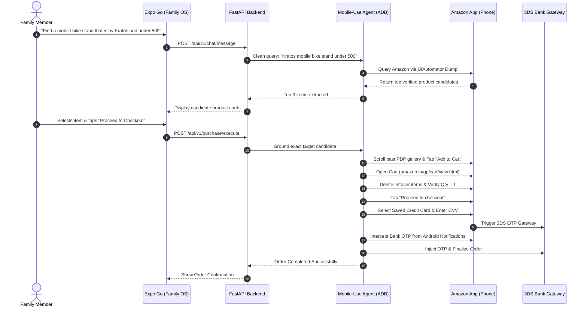

# Family OS

> A private, family-centric AI assistant featuring deterministic governance, fine-grained access control, real marketplace discovery, and autonomous mobile device control.

---

## Table of Contents

1. [Overview & Core Architecture](#1-overview--core-architecture)
2. [Dual-Agent Paradigm (Purchase Agent vs Mobile Use Agent)](#2-dual-agent-paradigm-purchase-agent-vs-mobile-use-agent)
3. [Key Capabilities & Features](#3-key-capabilities--features)
4. [Prerequisites Checklist](#4-prerequisites-checklist)
5. [Setup Guide: New Android Phone (or Switching Phones)](#5-setup-guide-new-android-phone-or-switching-phones)
6. [Setup Guide: New Laptop (First-Time Fresh Installation)](#6-setup-guide-new-laptop-first-time-fresh-installation)
7. [How to Run Again on the Same Device (Daily Restart Guide)](#7-how-to-run-again-on-the-same-device-daily-restart-guide)
8. [End-to-End Walkthrough (Search ➔ Cart Cleanup ➔ Checkout ➔ OTP)](#8-end-to-end-walkthrough-search--cart-cleanup--checkout--otp)
9. [Automated Tests & Quality Checks](#9-automated-tests--quality-checks)
10. [Troubleshooting & FAQ](#10-troubleshooting--faq)
11. [Documentation Index](#11-documentation-index)

---

## 1. Overview & Core Architecture

Family OS bridges conversational family-level intelligence with real-world physical mobile execution:

```text
┌────────────────────────────────────────────────────────────────────────┐
│                        PHYSICAL ANDROID PHONE                          │
│                                                                        │
│   ┌─────────────────────┐                 ┌────────────────────────┐   │
│   │   Expo Go Mobile    │                 │   Amazon Shopping      │   │
│   │   Family OS App     │                 │   (Native Android)     │   │
│   └──────────┬──────────┘                 └───────────▲────────────┘   │
└──────────────┼────────────────────────────────────────┼────────────────┘
               │ HTTP via USB Reverse                   │ Real Touch & UI Gestures
               │ (tcp:8000 & tcp:8081)                  │ via UIAutomator Hierarchy
┌──────────────▼────────────────────────────────────────┴────────────────┐
│                         DEVELOPMENT LAPTOP                             │
│                                                                        │
│  ┌───────────────────────┐             ┌────────────────────────────┐  │
│  │   FastAPI Backend     │◄───────────►│   Autonomous Mobile-Use    │  │
│  │   (Port 8000)         │             │   Agent (ADB Controller)   │  │
│  └───────────┬───────────┘             └────────────────────────────┘  │
│              │                                                         │
│  ┌───────────▼───────────┐             ┌────────────────────────────┐  │
│  │   FGP Policy Engine   │             │   Intent Extraction Engine │  │
│  │   & SQLite DB         │             │   (Deterministic / Ollama) │  │
│  └───────────────────────┘             └────────────────────────────┘  │
└────────────────────────────────────────────────────────────────────────┘
```

- **Family Governance Platform (FGP):** Deterministic policy engine (`ALLOW`, `DENY`, `ASK`). Language models assist with planning and conversation, but **never** make authorization or financial decisions.
- **Zero Mock Data:** All product discovery queries the live Amazon India catalog via your connected physical phone.
- **Direct UIAutomator Tree Inspection:** Fast, reliable mobile gestures executed with zero coordinate hallucinations and zero local GPU VRAM overhead.

---

## 2. Dual-Agent Paradigm (Purchase Agent vs Mobile Use Agent)

Family OS splits tasks between two specialized agents:

| Feature | 🛍️ Purchase Agent | 📱 Mobile-Use Agent |
| :--- | :--- | :--- |
| **Primary Role** | Conversational chat assistant, policy verification, candidate ranking, budget matching. | Autonomous on-device UI navigation, searching, candidate selection, cart management, and checkout. |
| **Execution Medium** | FastAPI backend + SQLite database. | Physical phone via Android Debug Bridge (ADB). |
| **AI / Inference Mode** | Deterministic keyword/regex parser (default, 0ms latency, 0 VRAM) with optional local Llama 3.2 via Ollama. | Direct Android UIAutomator XML hierarchy analysis + ADB gesture pipeline (`adb_bridge` mode). |
| **Active LLM in VRAM?** | **No** (runs instantly on CPU with zero heavy model weights). | **No** (operates via structural UI trees rather than heavy vision models). |

---

## 3. Key Capabilities & Features

1. **Conversational Query Normalization:**
   - Automatically strips conversational filler (`"Find a mobile bike stand that is by Kratos and under 500"` ➔ `"Kratos mobile bike stand under 500"`), ensuring Amazon's search algorithm returns exact, relevant results.
2. **Anti-Ad Grounding & Word-Boundary Matching:**
   - Filters out sponsored brand store headers (e.g. CASON banners) by enforcing strict word-boundary matching (`\b(one|touch|lock|360)\b`) and ignoring non-product card instances.
3. **Product Detail Page (PDP) Smart Auto-Scroll:**
   - Automatically swipes past large image carousels directly to the Buy Box, locating and tapping `add-to-cart-button`.
4. **Strict Cart Cleanup & Single-Product Verification:**
   - Navigates directly to `amazon.in/gp/cart/view.html`.
   - Inspects current cart items; automatically taps **Delete** on any leftover items or previous test accessories.
   - Decrements quantity to 1 if `Qty > 1`.
   - Verifies `Subtotal (1 item)` and confirms strictly the requested product is in the cart before initiating checkout.
5. **Autonomous Credit Card & Bank OTP Payment:**
   - Selects saved card, inputs CVV, and triggers the 3D Secure bank payment gateway.
   - Intercepts the bank authorization OTP in real-time from Android notification streams or the SMS inbox over ADB.
   - Automatically injects the OTP to complete checkout.
6. **Hard Payment Boundary (User Authorizes):**
   - For non-card payment methods (UPI, Net Banking, Biometrics), the agent halts touches immediately before payment confirmation, leaving the screen ready for physical user authorization.

---

## 4. Prerequisites Checklist

Ensure the following tools are available on your laptop:

| Tool | Minimum Version | Notes |
| :--- | :--- | :--- |
| **Python** | 3.12+ | Must be added to your system `PATH` ([python.org](https://www.python.org/downloads/)). |
| **Node.js** | 18+ (LTS) | Includes `npm` and `npx` ([nodejs.org](https://nodejs.org/)). |
| **Android ADB** | Platform Tools | Portable bundle included at `tools/platform-tools/` (or via Android Studio). |
| **Git** | Latest | Version control ([git-scm.com](https://git-scm.com/)). |
| **Ollama** *(Optional)* | Latest | Optional local LLM runtime for Llama 3.2 ([ollama.com](https://ollama.com/download)). |

### Phone Requirements:
- Any physical Android smartphone running **Android 9 to Android 14+** (tested on Samsung Galaxy A55 5G / One UI 6).
- USB Data Cable (supporting data transfer, not charge-only).
- **Expo Go** app installed from Google Play Store.
- **Amazon Shopping India** app installed from Google Play Store, signed in with your account, saved address, and payment method.

---

## 5. Setup Guide: New Android Phone (or Switching Phones)

Follow these steps whenever you connect a **new phone** or switch devices:

### Step 5.1: Enable Developer Options on Phone
1. Open phone **Settings**.
2. Tap **About phone** (or **About device**).
3. Tap **Software information** (if using Samsung, OnePlus, Xiaomi).
4. Tap **Build number** rapidly **7 times** until you see: *"You are now a developer!"*.

### Step 5.2: Enable USB Debugging
1. Go back to phone **Settings** ➔ **Developer options**.
2. Scroll to the **Debugging** section and toggle **USB debugging** to **ON**.
3. *(Recommended)* Toggle **"Stay awake"** ON while charging to prevent phone sleep during automation.

### Step 5.3: Connect Phone to Laptop via USB
1. Plug your phone into your laptop.
2. If prompted on the phone, select **"Transferring files / Android Auto"** (do NOT select "Charging only").
3. A popup will appear on your phone: **"Allow USB debugging?"**.
4. Check **"Always allow from this computer"** and tap **Allow**.

### Step 5.4: Verify Phone Connection & Get Serial Number
Open PowerShell on your laptop:
```powershell
d:\FamilyOS\tools\platform-tools\adb.exe devices
```
Expected output:
```text
List of devices attached
RZCX315YBJT    device
```
*(If it shows `unauthorized`, unlock your phone and accept the prompt).*

### Step 5.5: Update Device Serial in `.env` (If Switching Devices)
Open `backend\.env` and set your phone's serial:
```ini
ADB_DEVICE_SERIAL=YOUR_PHONE_SERIAL_HERE
```
> **Tip:** If only **one** Android device is plugged into your laptop, you can leave `ADB_DEVICE_SERIAL=` blank, and ADB will automatically target the connected device!

### Step 5.6: Reverse Ports for USB Networking
Run this command once after connecting the phone:
```powershell
d:\FamilyOS\tools\platform-tools\adb.exe reverse tcp:8000 tcp:8000
d:\FamilyOS\tools\platform-tools\adb.exe reverse tcp:8081 tcp:8081
```
*(This allows the phone to talk to your laptop's backend on port 8000 and Metro on port 8081 over the USB cable without needing Wi-Fi or firewall rules).*

---

## 6. Setup Guide: New Laptop (First-Time Fresh Installation)

If you are setting up Family OS on a brand new laptop, follow this step-by-step walkthrough:

### Step 6.1: Clone Repository
```powershell
git clone <your-repo-url> FamilyOS
cd FamilyOS
```

### Step 6.2: Setup Backend (Python & FastAPI)
1. Navigate to the `backend` directory:
   ```powershell
   cd backend
   ```
2. Create and activate a Python virtual environment:
   ```powershell
   python -m venv .venv
   .venv\Scripts\Activate.ps1
   ```
   *(On macOS/Linux: `source .venv/bin/activate`)*
3. Install backend dependencies:
   ```powershell
   pip install -r requirements.txt
   ```
4. Configure environment file:
   ```powershell
   Copy-Item .env.example .env
   ```
   Open `backend\.env` and verify key settings:
   ```ini
   APP_ENV=development
   HOST=0.0.0.0
   PORT=8000
   DATABASE_URL=sqlite+aiosqlite:///./family_os.db
   PRODUCT_PROVIDER=real_marketplace
   QWEN_AGENT_ENABLED=true
   QWEN_AGENT_MODE=adb_bridge
   ADB_BINARY_PATH=d:\FamilyOS\tools\platform-tools\adb.exe
   ADB_DEVICE_SERIAL=
   ```
5. Apply database schema migrations:
   ```powershell
   python -m alembic upgrade head
   ```
6. Bootstrap the initial Family Admin account:
   ```powershell
   python -m app.bootstrap
   ```
   Default credentials created:
   - **Email:** `admin@familyos.local`
   - **Password:** `AdminPass123!`

### Step 6.3: Setup Mobile App (Expo & React Native)
1. Open a new terminal and navigate to `apps/mobile`:
   ```powershell
   cd d:\FamilyOS\apps\mobile
   ```
2. Install frontend dependencies:
   ```powershell
   npm install --legacy-peer-deps
   ```
3. Create frontend `.env`:
   ```powershell
   Copy-Item .env.example .env
   ```
   Verify that `apps/mobile/.env` contains:
   ```ini
   EXPO_PUBLIC_API_BASE_URL=http://localhost:8000
   ```
4. Verify TypeScript builds without errors:
   ```powershell
   npm run type-check
   ```

### Step 6.4: (Optional) Setup Ollama for Local LLM
If you want to use local LLM chat inference instead of the instant deterministic intent parser:
1. Install and start Ollama: `ollama serve`
2. Pull the model: `ollama pull llama3.2`

---

## 7. How to Run Again on the Same Device (Daily Restart Guide)

Once your laptop and phone are set up, **you never need to reinstall packages or run migrations again**. Starting up takes less than 60 seconds.

### Option A: One-Click Startup Script (Recommended)
1. Plug your phone into your laptop via USB.
2. Run the included PowerShell startup helper:
   ```powershell
   powershell -ExecutionPolicy Bypass -File d:\FamilyOS\scripts\run_dev.ps1
   ```
   This automatically detects your phone, reverses ports 8000 and 8081, checks Ollama, and prints your ready commands.

---

### Option B: Quick Manual Startup (3 Terminals)

#### Step 1: Reverse Ports (Plug in Phone)
```powershell
d:\FamilyOS\tools\platform-tools\adb.exe reverse tcp:8000 tcp:8000; d:\FamilyOS\tools\platform-tools\adb.exe reverse tcp:8081 tcp:8081
```

#### Step 2: Start Backend (Terminal 1)
```powershell
cd d:\FamilyOS\backend
.venv\Scripts\Activate.ps1
python -m uvicorn app.main:app --host 0.0.0.0 --port 8000 --reload
```
You should see: `Uvicorn running on http://0.0.0.0:8000`.

#### Step 3: Start Mobile Bundler (Terminal 2)
```powershell
cd d:\FamilyOS\apps\mobile
npx expo start -c
```

#### Step 4: Open App on Phone
1. Open **Expo Go** on your Android phone.
2. Under **Development servers**, tap **Family OS** (or enter `exp://localhost:8081`).
3. Sign in with:
   - **Email:** `admin@familyos.local`
   - **Password:** `AdminPass123!`

---

## 8. End-to-End Walkthrough (Search ➔ Cart Cleanup ➔ Checkout ➔ OTP)

Here is how the automated workflow functions when shopping on Amazon:



1. **User asks for an item:**
   In the chat on your phone:
   > *"Find a mobile bike stand that is by Kratos and under 500"*
2. **Real Marketplace Extraction:**
   - Intent is extracted; search query is normalized to `"Kratos mobile bike stand under 500"`.
   - The Mobile-Use Agent executes an ADB UI dump of Amazon India to retrieve genuine, live product options.
   - The top 3 ranked product cards appear on the phone screen with exact prices and Prime badges.
3. **Select Product & Trigger Checkout:**
   - The user selects the desired product card and clicks **Proceed to Checkout**.
4. **Autonomous Phone Takeover & Anti-Ad Grounding:**
   - Amazon opens on your phone.
   - The agent skips sponsored banners (like CASON brand stores) using whole-word boundary matching.
   - It taps the exact matching product card.
   - On the product detail page (PDP), it scrolls past the image carousel directly to the Buy Box and taps **Add to Cart**.
5. **Cart Verification & Cleanup:**
   - The agent loads the Amazon Shopping Cart (`amazon.in/gp/cart/view.html`).
   - It checks the hierarchy for extraneous items and taps **Delete** on any older items or test products.
   - It verifies that the cart subtotal is strictly `Subtotal (1 item)`.
   - Taps **Proceed to checkout**.
6. **Payment & OTP Interception:**
   - Selects the saved credit card and inputs CVV.
   - Intercepts the 6-digit bank authorization OTP in real-time from the Android notification stream or SMS inbox via ADB.
   - Injects the OTP into the bank's 3DS gateway to complete the purchase.

---

## 9. Automated Tests & Quality Checks

Run the automated test suite covering FGP policies, security isolation, and agent lifecycles:

### Run Backend Pytest Suite:
```powershell
cd d:\FamilyOS\backend
python -m pytest tests/ -v
```
*(All 39 unit, integration, and security tests run in ~2.5 seconds using in-memory SQLite fixtures).*

### Run Frontend Typecheck:
```powershell
cd d:\FamilyOS\apps\mobile
npm run type-check
```

---

## 10. Troubleshooting & FAQ

### Q: `adb devices` shows `unauthorized`
- Unlock your Android phone.
- Look for the popup dialog: *"Allow USB debugging from this computer?"*.
- Check *"Always allow"* and tap **Allow**.

### Q: `adb devices` shows an empty list
- Ensure your USB cable supports **data transfer** (some cables are charge-only).
- Try plugging into a different USB port on your laptop.
- Verify that **USB Debugging** is toggled ON under phone *Settings > Developer options*.
- Ensure USB mode on phone is set to **File Transfer / MTP**.

### Q: Phone shows "Cannot reach server" or Network Error in Expo Go
- Make sure you ran the port reverse commands:
  ```powershell
  d:\FamilyOS\tools\platform-tools\adb.exe reverse tcp:8000 tcp:8000
  d:\FamilyOS\tools\platform-tools\adb.exe reverse tcp:8081 tcp:8081
  ```
- Ensure the FastAPI backend is running: `python -m uvicorn app.main:app --host 0.0.0.0 --port 8000 --reload`.

### Q: I switched to a different phone and ADB cannot find it
- Run `d:\FamilyOS\tools\platform-tools\adb.exe devices`.
- Copy your new phone's serial string.
- Open `backend\.env` and update `ADB_DEVICE_SERIAL=<your_new_phone_serial>`.
- Re-run the port reverse command: `adb reverse tcp:8000 tcp:8000; adb reverse tcp:8081 tcp:8081`.

### Q: Metro bundler shows a red error or stale bundle
- Clear the Expo/Metro cache:
  ```powershell
  cd d:\FamilyOS\apps\mobile
  npx expo start -c
  ```

### Q: Is an LLM model running or consuming VRAM?
- **No.** The Mobile-Use Agent operates via direct UIAutomator tree inspection (`adb_bridge`), which consumes 0 MB of VRAM. The Purchase Agent uses an instant deterministic parser fallback by default. No heavy model weights are loaded into GPU memory.

---

## 11. Documentation Index

- **[Architecture & Subsystems](docs/ARCHITECTURE.md)**: Deep dive into the FGP policy engine and agent lifecycle.
- **[Comprehensive End-to-End Workflow (PDF)](docs/WORKFLOW_END_TO_END.pdf)**: Visual guide and architecture slides.
- **[Comprehensive End-to-End Workflow (Markdown)](docs/WORKFLOW_END_TO_END.md)**: Full text description of the end-to-end shopping journey.
- **[Setup & Deployment Guide](docs/SETUP.md)**: Production deployment instructions.
- **[REST API Reference](docs/API.md)**: Detailed endpoints, schemas, and payloads.
- **[Security & FGP Governance](docs/SECURITY.md)**: Formal security specifications and data isolation.
- **[Purchase & Mobile Execution Flow](docs/PURCHASE_FLOW.md)**: Step-by-step state machine for autonomous execution.
- **[Troubleshooting Guide](docs/TROUBLESHOOTING.md)**: Expanded diagnostic steps for ADB, React Native, and Uvicorn.
