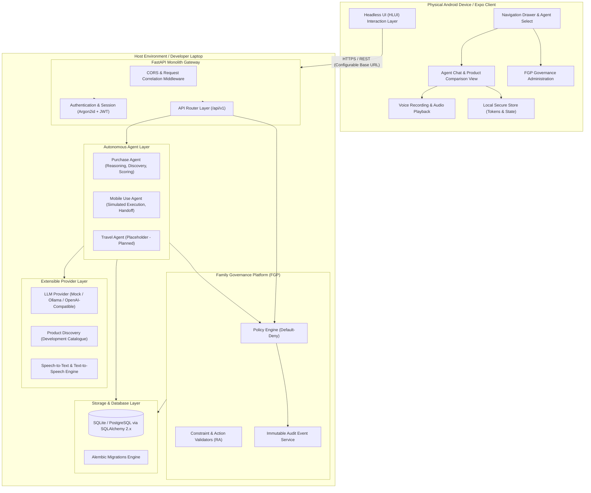
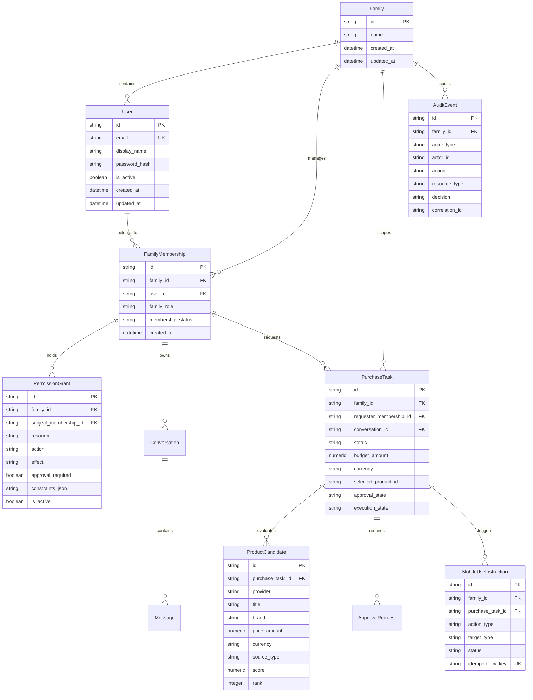

# Family OS — Architectural Design Document

## 1. System Overview

**Family OS** is an AI-powered, family-centric operating environment designed around privacy, strict governance boundaries, and autonomous agent collaboration. Unlike generic consumer AI assistants that expose all context to a centralized model or lack fine-grained authorization, Family OS implements a **deterministic Family Governance Platform (FGP)** that mediates all agent actions and data access.

The system is architected as a mobile-first distributed application:
- **Client Layer:** A native mobile application (Expo / React Native / TypeScript) running on physical Android devices and development environments.
- **Backend & Orchestration Layer:** A modular FastAPI backend running on developer workstations or dedicated private home servers, exposing strict REST APIs, handling task lifecycles, and managing persistence.
- **Intelligence Layer:** An abstracted LLM provider interface that decouples reasoning from authorization, defaulting to local inference runtimes (e.g., Ollama / vLLM) with deterministic fallback mocks.

---

## 2. High-Level System Architecture

---

## 3. Core Architectural Subsystems

### 3.1 Family Governance Platform (FGP)
The FGP is the central security authority of Family OS. Crucially, **the AI model is never the authority for permissions or policy decisions**.
- **Default-Deny:** In the absence of an explicit, valid `ALLOW` grant in the `PermissionGrant` registry, every action across the system is rejected (`NO_GRANT`).
- **Deterministic Evaluation:** The policy engine (`app/policies/engine.py`) evaluates subject membership, family membership status, target resource, action, and context constraints without any probabilistic inference.
- **Approval Interception:** An allow grant flagged with `approval_required=True` triggers an `ASK` effect, creating an `ApprovalRequest` record that halts execution until an authorized adult/admin approves or denies it.
- **Family Isolation:** Multi-tenancy is strictly isolated at the query level by joining on `family_id` and verifying user active membership. Cross-family data queries return `404 Not Found` or `403 Forbidden`.

### 3.2 Headless UI (HLUI) Mobile Client
The HLUI is the user-facing interaction layer running within Expo React Native (`apps/mobile`):
- **Dynamic Context:** Switches dynamically based on the active family member's role (`ADMIN`, `ADULT_MEMBER`, `CHILD_MEMBER`).
- **Agent Drawer:** Exposes exactly two agents for the initial release:
  1. **Purchase Agent:** Functional text, voice, product comparison, selection, and simulated checkout flow.
  2. **Travel Agent:** Unambiguous placeholder screen declaring future implementation.
- **FGP Admin Console:** Dedicated administrative view visible only to administrators for managing grants, toggling approval requirements, and inspecting audit trails.
- **Configurable Connectivity:** Uses `EXPO_PUBLIC_API_BASE_URL` to route requests over the local Wi-Fi network directly to the laptop's LAN IP address without relying on `localhost`.

### 3.3 Purchase Agent Subsystem
The Purchase Agent is the first fully operational autonomous assistant in Family OS:
- **Conversation State:** Maintains a structured conversation log in SQLite.
- **Intent Extraction:** Utilizes structured system prompts to parse search parameters (category, budget, brand preferences, specifications).
- **Catalogue Search & Multi-Factor Scoring:** Searches catalog providers and ranks candidates using a deterministic scoring formula:
  $$\text{Score} = \text{Base}(15) + \text{BudgetMatch}(40) + \text{BrandMatch}(20) + \text{InStock}(15) + \text{SpecsCompleteness}(10)$$
- **Structured Recommendations:** Delivers structured product cards to the mobile UI alongside transparent badges indicating whether data originates from live feeds or the development catalogue.

### 3.4 Mobile Use Agent Subsystem (Powered by Qwen Intelligence)
The Mobile Use Agent handles device-level execution after purchase selection and authorization:
- **Qwen Intelligence Integration:** Powered by the Alibaba Qwen Intelligence Mobile-Use Agent architecture (Qwen-UI-Agent / Qwen2.5-VL), adopting an "API-first with GUI fallback" approach.
- **Visual Grounding & Action Loop:** Supports multi-step UI reasoning on Android screens (1080×2400 viewport):
  1. `OPEN_APP`: Launches shopping environment via OS intent.
  2. `GROUND_AND_TYPE`: Visually identifies search box coordinates and types query.
  3. `GROUND_AND_TAP`: Grounds candidate product tile and taps.
  4. `SWIPE_AND_INSPECT`: Evaluates in-stock status and product specifications.
  5. `ADD_TO_CART`: Locates primary CTA and adds to cart.
  6. `NAVIGATE_TO_CHECKOUT`: Advances to order review screen.
  7. `PAUSE_FOR_USER_PAYMENT`: **Hard Payment Boundary** enforced.
- **The Hard Payment Boundary:** The agent is strictly prohibited by Family OS security policies from executing the final payment click. It stages the order, verifies all details, and halts with `status: PAUSED_FOR_USER_CONFIRMATION` requiring manual biometric (fingerprint/face) or PIN entry by the family member.
- **Dual Runtime Support:** Supports deterministic visual grounding simulation (`simulation`), direct local VLM endpoint inference (`vlm_direct`), and real Android device gesture dispatch via ADB over Wi-Fi (`adb_bridge`).
- **Idempotency Protection:** Enforces unique idempotency keys on all `MobileUseInstruction` records to prevent duplicate actions.
- **Transparent Disclaimers:** All simulation modes explicitly flag `"Simulation completed — no real purchase was made."` and show interactive visual grounding traces in the mobile UI.

---

## 4. Entity-Relationship Model (Database Schema)

---

## 5. Extensibility Path for Future Agents

Family OS is intentionally designed to support future agents (Travel, Health, Finance, Education, Home Automation) without modifying the core platform:
1. **Agent Registration:** Register new agent identifiers in `app/db/models/conversation.py` (`AgentType` enum) and `app/api/agents.py`.
2. **Resource-Action Definition:** Define fine-grained permissions in `app/policies/rules.py` (e.g. `travel.booking/create`, `health.record/read`).
3. **Agent Class Implementation:** Subclass `BaseAgent` (`app/agents/base.py`) and implement `process_message()`.
4. **FGP Policy Baseline:** Add default member permissions in `app/policies/defaults.py` ensuring adult vs. child boundaries.
5. **UI Plug-in:** Add navigation items in `apps/mobile/src/components/SidebarDrawer.tsx` pointing to dedicated route views.
