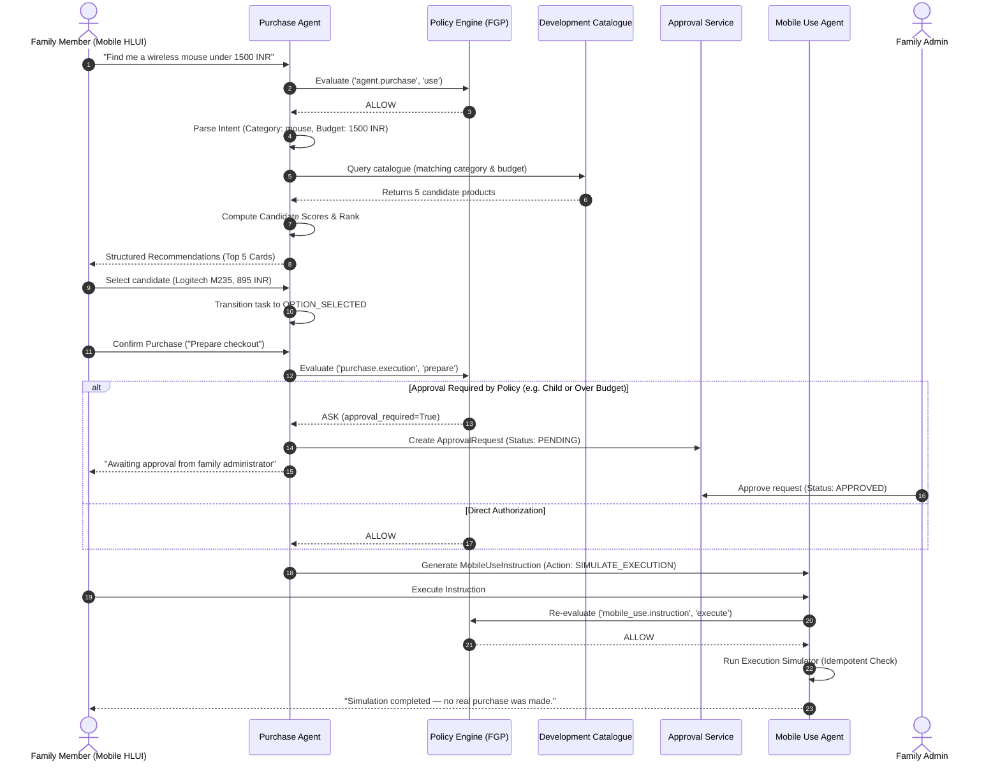
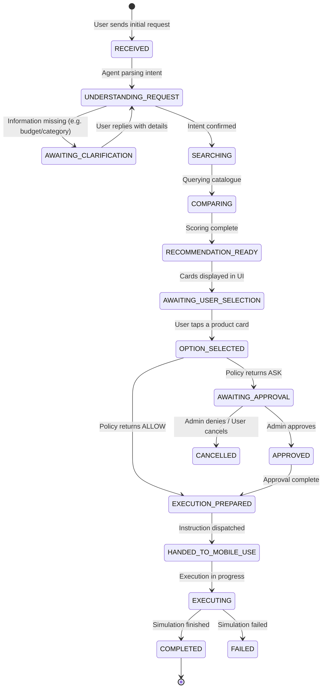

# Family OS — Purchase Workflow & Mobile Execution

This document details the complete end-to-end operational lifecycle of a purchase in Family OS, from user conversational intent to simulated mobile device execution.

---

## 1. End-to-End Workflow Walkthrough



---

## 2. PurchaseTask State Machine

The `PurchaseTask` model tracks the state of the shopping flow through explicit, auditable transitions:



---

## 3. Product Discovery & Multi-Factor Scoring

When searching product providers (e.g. the built-in development catalogue), candidates are scored deterministically based on customer priorities:

$$\text{Candidate Score} = \text{Base} + \text{BudgetBonus} + \text{BrandBonus} + \text{StockBonus} + \text{SpecCompleteness}$$

- **Base Score:** $+15$ points
- **Budget Match:** $+40$ points if $\text{Price} \le \text{Budget}$; $+0$ if price exceeds budget.
- **Brand Preference:** $+20$ points if the candidate's brand matches any user preferred brand.
- **Availability:** $+15$ points if item is currently in stock.
- **Data Completeness:** $+10$ points if warranty, delivery estimates, and return policies are provided.

Candidates are ranked in descending order by score and presented with rank badges (`#1 Recommended`, `#2`, etc.) in the Headless UI.

---

## 4. Mobile Use Agent & Safe Simulation

### 4.1 Supported Instruction Actions
The Mobile Use Agent receives instructions conforming to the `MobileUseInstruction` schema:
1. `QWEN_MOBILE_EXECUTION`: Autonomous mobile grounding and action loop powered by Alibaba's Qwen Intelligence Mobile-Use Agent (Qwen-UI-Agent / Qwen2.5-VL). Executes multi-step visual grounding on an Android 1080×2400 viewport and strictly halts before payment for user biometric confirmation.
2. `SIMULATE_EXECUTION`: Standard mock checkout verifying all validation criteria without real financial transaction processing.
3. `OPEN_PRODUCT_URL`: Safely opens an external verified HTTPS link in the system browser.
4. `PREPARE_PURCHASE`: Stages item metadata into a local checkout buffer for manual review.

### 4.2 Qwen Mobile Visual Grounding & Hard Payment Boundary
When executing via `QWEN_MOBILE_EXECUTION`, the agent generates an auditable 7-step visual grounding trace:
- **Step 1 (`OPEN_APP`):** Launches the shopping application via OS intent.
- **Step 2 (`GROUND_AND_TYPE`):** Locates the search box (`[540, 160]` px) and inputs the query.
- **Step 3 (`GROUND_AND_TAP`):** Visually identifies the matching product tile (`[540, 780]` px), verifies pricing against max spend constraints, and taps to open.
- **Step 4 (`SWIPE_AND_INSPECT`):** Scrolls vertically (`[540, 1200]` px) to check in-stock status and product specifications.
- **Step 5 (`ADD_TO_CART`):** Taps the Add to Cart CTA (`[540, 1920]` px).
- **Step 6 (`NAVIGATE_TO_CHECKOUT`):** Navigates to the address selection and final review screen (`[880, 2150]` px).
- **Step 7 (`PAUSE_FOR_USER_PAYMENT`):** **Safety Boundary Enforced.** The agent detects the payment trigger and halts immediately with status `PAUSED_FOR_USER_CONFIRMATION`. A family member must provide physical biometric (fingerprint/face) or UPI PIN confirmation.

### 4.3 Idempotency Guarantees
Every `MobileUseInstruction` requires a unique `idempotency_key` (e.g., `exec_<task_id>_<cand_id>`).
- If an execution request is retried with the same idempotency key after success, the agent returns the cached execution result with HTTP 200 without re-running side effects.
- If an operation is already currently executing, the system rejects duplicate concurrent invocations.

### 4.4 Simulation Output Guarantee
To ensure zero confusion between testing and real payments:
- All simulated executions explicitly log and return:
  ```json
  {
    "simulation": true,
    "message": "Simulation completed — no real purchase was made.",
    "product_title": "Logitech M235 Wireless Mouse",
    "amount": 895.0,
    "currency": "INR"
  }
  ```
- The mobile UI displays an amber warning banner clearly designating test data.
