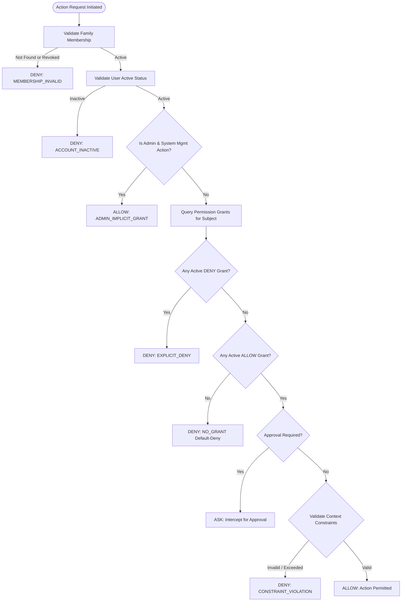

# Family OS — Security Architecture and Governance Model

## 1. Threat Model & Security Philosophy

Traditional smart home assistants operate with ambient eavesdropping and execute actions under a single shared credential with zero accountability. Family OS addresses these structural security flaws through:

1. **Autonomous Agents Without Direct Privileges:** Agents cannot perform financial transactions or invoke device operations directly; all actions are mediated through discrete, audited instructions validated by the **Family Governance Platform (FGP)**.
2. **AI Is Never an Authorization Authority:** The LLM's role is restricted to natural language understanding, comparison, and formatting. Policy evaluations are 100% deterministic code.
3. **Default-Deny Access Control:** No action is permitted unless an explicit active grant exists in the database.
4. **Strong Family Isolation:** Multi-family isolation prevents cross-tenant data leakage.

---

## 2. Family Governance Platform (FGP)

### 2.1 Policy Evaluation Algorithm
The Policy Engine (`app/policies/engine.py`) executes the following sequential evaluation flow:

### 2.2 Roles and Privileges
- **`ADMIN`:**
  - Manages family members, roles, and fine-grained permission grants.
  - Can review and approve/deny pending purchase requests.
  - Can inspect immutable audit logs.
  - *Constraint:* Does not have automatic implicit access to inspect another member's private messages or tasks without a grant.
- **`ADULT_MEMBER`:**
  - Full access to converse with the Purchase Agent.
  - Allowed to prepare purchase executions up to pre-configured spend thresholds.
  - May approve child requests if granted the approval privilege.
- **`CHILD_MEMBER`:**
  - Allowed to converse with the Purchase Agent and explore products.
  - Cannot prepare or execute purchases without explicit adult approval (`approval_required=True`).
  - Cannot modify permissions or invite members.

### 2.3 Constraint Validation
Grants can attach structured JSON constraints (e.g. `{"max_spend": 1500, "currency": "INR", "allowed_categories": ["books", "electronics"]}`).
The policy validator strictly checks:
- Budget limits (`price <= max_spend`)
- Approved currency codes
- Unknown or malformed security attributes are rejected immediately (`UNKNOWN_CONSTRAINT_KEY`).

---

## 3. Multi-Tenancy & Family Isolation

Every persistent entity in Family OS (`Conversation`, `PurchaseTask`, `ApprovalRequest`, `MobileUseInstruction`, `AuditEvent`, `PermissionGrant`) is bound to a mandatory `family_id` foreign key.

### Query-Level Isolation
- Application services enforce double verification:
  1. The authenticated user must belong to `family_id` with `membership_status == ACTIVE`.
  2. The target entity must belong to `family_id`.
- Attempts to query an ID belonging to a different family return `404 Not Found` (to avoid ID enumeration) or `403 Forbidden`.
- Verified in automated test suite: `tests/security/test_auth_isolation.py::test_cross_family_isolation`.

---

## 4. Audio Privacy & Voice Data Handling

Family OS treats voice as an ephemeral input channel rather than a continuous monitoring system:
- **No Wake-Word Daemon:** The mobile application uses an explicit push-to-talk button (`useVoiceRecorder`). The microphone is active only while the user holds or activates recording.
- **Microphone Permissions:** Explicit OS permission prompts on Android / iOS with transparent usage descriptions.
- **File Deletion:** Uploaded audio chunks sent to `/api/v1/voice/transcribe` are written to temporary storage, processed in-memory by the STT provider, and immediately deleted via `os.unlink()`.
- **Audio References:** Audio binaries are never persisted in plain database fields. Only text transcriptions are stored in the conversation history.

---

## 5. Credential & Session Management

- **Password Hashing:** Passwords are never stored in plaintext. Passwords are salted and hashed using **Argon2id** (`argon2-cffi`), the winner of the Password Hashing Competition.
- **JWT Authentication:** Stateless JSON Web Tokens using `HS256` signed by a high-entropy secret (`SECRET_KEY`).
  - Access Token lifespan: 1 hour.
  - Refresh Token lifespan: 30 days.
- **Secure Client Storage:** On Android devices, tokens are stored in hardware-backed storage via `expo-secure-store` (Android Keystore / iOS Keychain), never in unencrypted local storage.

---

## 6. Audit Trail & Immutability

Every security-sensitive operation creates an immutable `AuditEvent` record:
- User logins and failures
- Family member invitations
- Permission grant creation, modifications, and deletions
- Approval requests, decisions, and rejections
- Mobile Use instruction preparation and execution

### Audit Record Schema
| Field | Type | Description |
|---|---|---|
| `id` | `UUID` | Unique event identifier |
| `family_id` | `UUID` | Scoped family identifier |
| `actor_type` | `string` | `USER`, `AGENT`, or `SYSTEM` |
| `actor_id` | `UUID` | Identifier of requesting membership |
| `action` | `string` | Action performed (e.g. `family.permissions/update`) |
| `resource_type` | `string` | Target resource (`permission_grant`, `purchase_task`) |
| `decision` | `string` | `ALLOW`, `DENY`, or `ASK` |
| `reason_code` | `string` | FGP evaluation code (`ADMIN_IMPLICIT_GRANT`, etc.) |
| `correlation_id` | `string` | Request correlation ID for end-to-end tracing |
| `metadata_json` | `JSON` | Sanitized context (never contains passwords or tokens) |
| `created_at` | `DateTime` | UTC timestamp |
