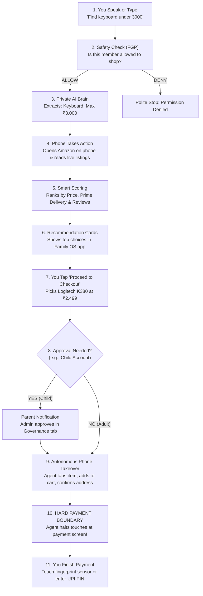
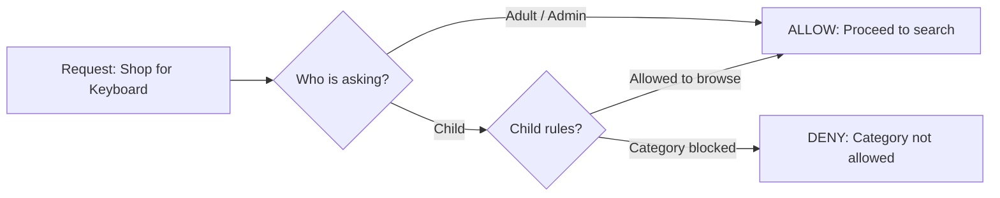
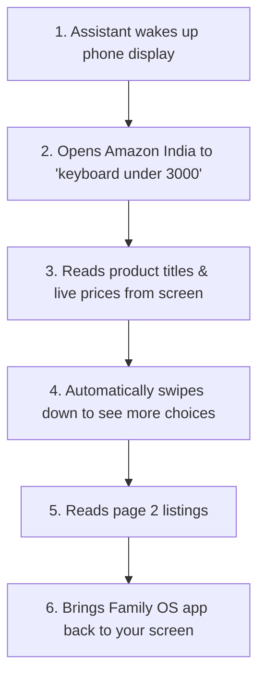

# Family OS — How It Works: The Visual Workflow Guide

> **A Simple, Step-by-Step Visual Guide from Initial Setup to Safe Autonomous Checkout**
> 
> *Target Audience:* Everyone (Family Members, Developers, and Evaluators)  
> *Core Story:* Asking for a **"Keyboard under ₹3,000"** and watching the phone safely navigate to checkout.

---

## 1. The 30-Second Big Picture

**Family OS** is a private, family-safe AI assistant that helps your family find products and autonomously prepares them for purchase on your physical Android phone — **without ever spending your money without your permission.**

Unlike ordinary chatbots that suggest fake products or generic smart speakers that buy things without asking, Family OS connects your laptop's private AI brain directly to your physical smartphone via USB:

```
┌────────────────────────────────────────────────────────────────────────┐
│                        WHAT YOU SEE ON YOUR DESK                       │
│                                                                        │
│   ┌─────────────────────────────┐         ┌────────────────────────┐   │
│   │    YOUR ANDROID PHONE       │         │   YOUR LAPTOP / SERVER │   │
│   │                             │         │                        │   │
│   │  • Family OS App (Chat)     │◄───────►│  • Local AI Brain      │   │
│   │  • Amazon App (Live Store)  │   USB   │    (Ollama / Llama 3.2)│   │
│   │  • Your Fingerprint Sensor  │  Cable  │  • Family Safety Rules │   │
│   └─────────────────────────────┘         └────────────────────────┘   │
└────────────────────────────────────────────────────────────────────────┘
```

---

## 2. The 3 Golden Rules of Family OS

```
┌────────────────────────────────────────────────────────────────────────┐
│                        THE 3 GOLDEN RULES                              │
│                                                                        │
│  1. ZERO FAKE DATA (Real Marketplace)                                  │
│     The assistant never invents products. It opens real Amazon on      │
│     your phone, checks live prices in Rupees, and reads real stock.    │
│                                                                        │
│  2. DETERMINISTIC SAFETY (The Family Bouncer)                          │
│     The AI never decides if someone is allowed to buy something.       │
│     Strict family rules govern spend limits, roles, and approvals.     │
│                                                                        │
│  3. THE HARD PAYMENT BOUNDARY (You Keep Control)                       │
│     The assistant drives the phone through search, cart, and address,  │
│     but STOPS DEAD at the payment screen. It leaves Amazon open so     │
│     YOU authorize the final payment with your fingerprint or UPI PIN.  │
└────────────────────────────────────────────────────────────────────────┘
```

---

## 3. Master Workflow Diagram

Here is the entire journey from your spoken words to the final checkout screen:



---

## 4. Step-by-Step Walkthrough: "Keyboard under ₹3,000"

Let's follow one complete, real-life scenario from start to finish.

---

### Step 1: Connecting the System (Plug & Play)

```
┌────────────────────────────────────────────────────────────────────────┐
│                        HARDWARE CONNECTION                             │
│                                                                        │
│   1. Plug phone into laptop with USB cable (enable USB Debugging).     │
│   2. The laptop runs a quick port-forwarding command (adb reverse).    │
│   3. Open the Family OS app on your phone.                             │
│                                                                        │
│   Result: Phone and laptop are in instant, private communication.      │
│   Zero Wi-Fi firewall issues. Zero cloud eavesdropping.                │
└────────────────────────────────────────────────────────────────────────┘
```

- **On your laptop:** The private AI brain ([Ollama](http://127.0.0.1:11434)) and the Family OS server run locally.
- **On your phone:** You open the Family OS mobile app.

---

### Step 2: You Ask for a Product

You tap the microphone or type in the Purchase Agent chat:
> **"Find keyboard under 3000"**

```
┌────────────────────────────────────────────────────────────────────────┐
│  WHAT HAPPENS IN 0.1 SECONDS:                                          │
│                                                                        │
│  • If you typed: The text is sent straight to the assistant.           │
│  • If you spoke: The app records your voice while holding the button,  │
│    converts it to text, and IMMEDIATELY DELETES the audio recording.   │
│    No raw voice files are ever stored. Privacy is 100% guaranteed.     │
└────────────────────────────────────────────────────────────────────────┘
```

---

### Step 3: The Family Bouncer Checks Permissions

Before the AI even looks at your message, the **Family Governance Platform (FGP)** checks your house rules:



- **Adults & Parents:** Can search freely and checkout up to their family limit.
- **Children:** Can search and explore, but **cannot purchase** without parent approval.
- **Deterministic:** The AI model never decides permissions. Rules are written in strict code.

---

### Step 4: The Local AI Brain Understands Your Intent

Your request is sent to the local AI model (Llama 3.2) running on your laptop:

```
┌────────────────────────────────────────────────────────────────────────┐
│                        AI INTENT PARSING                               │
│                                                                        │
│   Input:   "Find keyboard under 3000"                                  │
│                                                                        │
│   AI Figures Out:                                                      │
│   • Category:  KEYBOARD                                                │
│   • Search:    keyboard                                                │
│   • Budget:    Rs. 3,000 (INR)                                         │
│   • Action:    Ready to search live marketplace immediately            │
└────────────────────────────────────────────────────────────────────────┘
```

The AI does not stall with useless questions. It immediately triggers live product discovery.

---

### Step 5: Real Shopping on Your Phone (Live Amazon Scraping)

Now watch your phone! The assistant uses **Android Debug Bridge (ADB)** to inspect the live marketplace:



```
┌────────────────────────────────────────────────────────────────────────┐
│  WHY THIS IS DIFFERENT FROM CHATGPT / ALEXA:                           │
│                                                                        │
│  • Alexa suggests sponsored items linked to one default account.       │
│  • ChatGPT invents prices and links that are often outdated or broken. │
│  • Family OS reads genuine, live prices on your actual phone screen    │
│    right now, filtering out any item above Rs. 3,000.                  │
└────────────────────────────────────────────────────────────────────────┘
```

---

### Step 6: Smart Multi-Factor Ranking & Product Cards

The assistant grades every keyboard it found using an unbiased scoring formula:

```
┌────────────────────────────────────────────────────────────────────────┐
│                        HOW CANDIDATES ARE SCORED                       │
│                                                                        │
│   + 15 pts: Base score for any valid product                           │
│   + 40 pts: Price is within your Rs. 3,000 budget                      │
│   + 20 pts: Brand match (Logitech, HP, Redragon, Portronics)           │
│   + 15 pts: Currently in stock with fast delivery                      │
│   + 10 pts: Full warranty & 7-day replacement details available        │
│                                                                        │
│   TOTAL: Up to 100 points                                              │
└────────────────────────────────────────────────────────────────────────┘
```

#### What You See on Your Phone Screen:
The Family OS app displays a clean carousel of product cards:

| Rank | Product Title | Real Price | Delivery | Action |
| :---: | :--- | :---: | :--- | :---: |
| **#1** | **Logitech K380 Multi-Device Wireless** | **Rs. 2,499** | Free One-Day Prime | `[Proceed to Checkout ->]` |
| **#2** | **Redragon K552 Mechanical Keyboard** | **Rs. 2,799** | Two-Day Delivery | `[Proceed to Checkout ->]` |
| **#3** | **HP 150 Wireless Keyboard & Mouse** | **Rs. 1,299** | One-Day Prime | `[Proceed to Checkout ->]` |
| **#4** | **Portronics Bubble Multimedia Wireless** | **Rs. 999** | One-Day Prime | `[Proceed to Checkout ->]` |

---

### Step 7: You Select & Proceed to Checkout

You pick the **Logitech K380 at Rs. 2,499** and tap **"Proceed to Checkout ➔"**.

```mermaid
flowchart TD
    Tap["You tap 'Proceed to Checkout'"] --> CheckRole{"Is user an Adult or Child?"}
    CheckRole -->|Adult (Within Limit)| AutoApproved["Approved Immediately<br/>Proceeds to phone automation"]
    CheckRole -->|Child Account| NeedsApproval["HALT: Parent Approval Required<br/>Notification sent to Admin"]
    NeedsApproval --> ParentDecides{"Parent reviews on their phone"}
    ParentDecides -->|Approved| AutoApproved
    ParentDecides -->|Rejected| Denied["Task Cancelled politely"]
```

---

### Step 8: Autonomous Phone Takeover (Touch by Touch)

Once approved, the **Mobile-Use Agent** drives the Amazon app on your phone. You can watch your phone screen as it performs each action:

```
┌────────────────────────────────────────────────────────────────────────┐
│                     WATCH YOUR PHONE SCREEN!                           │
│                                                                        │
│   Step 1: Opens Amazon directly to the Logitech K380 page.             │
│   Step 2: Locates and taps the Logitech K380 product card.             │
│   Step 3: Taps the yellow "Buy Now" button (or "Add to Cart").         │
│   Step 4: Confirms your saved home delivery address.                   │
│   Step 5: Detects any Amazon Prime upsell popups ("Join Prime for      │
│           Rs. 1499") and automatically taps "No Thanks".               │
│   Step 6: Lands on the final Payment Screen (UPI / Cards / GPay).      │
└────────────────────────────────────────────────────────────────────────┘
```

---

### Step 9: The Hard Payment Boundary (Safety Stop!)

This is the most critical security design in Family OS:

```
┌────────────────────────────────────────────────────────────────────────┐
│                                                                        │
│                     STOP! THE HARD PAYMENT BOUNDARY                    │
│                                                                        │
│   The phone is now on the Amazon Payment Screen showing:               │
│   • Payment options: UPI (Google Pay, PhonePe), NetBanking, Cards      │
│   • Final Order Total: Rs. 2,499.00                                    │
│   • Delivery Address: Your Home                                        │
│                                                                        │
│   ==================================================================   │
│                  THE ASSISTANT STOPS TOUCHES HERE                      │
│   ==================================================================   │
│                                                                        │
│   The AI will NEVER:                                                   │
│   X Click "Pay Now" or "Place Your Order"                              │
│   X Enter your UPI PIN                                                 │
│   X Enter your card CVV or bank OTP                                    │
│   X Read your biometric sensors                                        │
│                                                                        │
│   WHAT YOU DO:                                                         │
│   1. Pick up your phone.                                               │
│   2. Review the Rs. 2,499 total on Amazon.                             │
│   3. Touch your fingerprint sensor or enter your UPI PIN to pay.       │
│                                                                        │
└────────────────────────────────────────────────────────────────────────┘
```

---

## 5. Summary Table: What You See vs. What Happens Behind the Scenes

| Stage | What You Experience on Phone | What Happens Behind the Scenes | Safety Guarantee |
| :--- | :--- | :--- | :--- |
| **1. Request** | Speak or type: *"Find keyboard under 3000"* | Audio converted to text; raw audio file deleted immediately | No voice recordings stored |
| **2. Policy Check** | Quick instant spinner | Deterministic FGP engine verifies your family role and spend limit | AI cannot bypass permissions |
| **3. Intent** | *"Searching for keyboards under Rs. 3,000..."* | Local Llama 3.2 model parses category and budget limit | 100% private on your laptop |
| **4. Discovery** | Phone opens Amazon, scrolls, and returns to app | Assistant dumps screen accessibility nodes; maps prices to items | Zero fake or outdated data |
| **5. Selection** | You see ranked cards; tap **Proceed to Checkout** | Multi-factor scorer ranks options ($15$ base + $40$ budget + $15$ stock) | Unbiased, mathematical ranking |
| **6. Approval** | Adult proceeds; child sees "Awaiting parent approval" | Parent reviews request in Governance console and approves | Kids cannot spend money |
| **7. Navigation** | Watch phone tap Buy Now, pick address, and skip upsells | Grounded coordinate taps via ADB bridge | Fully transparent touch trace |
| **8. Checkout** | Phone screen pauses on UPI / Payment options | **Touch execution halts dead.** Agent marks task complete | **Human fingerprint / PIN required** |

---

## 6. Frequently Asked Questions

### Can the assistant ever spend my money without me knowing?
**No. Never.** The Hard Payment Boundary is built into the engine code. The agent is physically programmed to halt before any payment button. You must physically authorize the purchase using your fingerprint, face ID, or UPI PIN.

### What if my phone is not connected via USB?
If no phone is plugged in, Family OS automatically switches to its built-in development catalogue so you can still test and explore without errors.

### Do I need to pay for an expensive cloud AI subscription?
**No.** The AI runs 100% locally on your laptop using free, open-source models via Ollama (Llama 3.2). Your family data never leaves your home network.

---

*Family OS — Safe, private, and autonomous home assistance with complete human control.*
