# FamilyOS database schema

PostgreSQL. Generated 2026-10-21 from the live schema (98 migrations applied, 87 tables). Schema only, no data.
Regenerate with `.venv/bin/python scripts/schema_docs.py`.

## Conventions

- Every table that belongs to a household carries `household_id` and cascades on delete.
- Primary keys are UUIDs. Timestamps are `timestamptz` in UTC.
- Originals are never in the database: `blobs` points at sealed objects in object storage (see `object-storage.md`).
- Derived facts (`claims`, `obligations`, `medications`, `receipt_items`) point back at the notice they were read from. Deleting the notice removes them.
- Card numbers, passwords and one-time codes are never stored. A payment card is the provider's id only.
- Visibility (private or shared, handed to a person, a child's consent) is enforced in queries, not by row-level security.

## Relationships

Arrows point from the table holding the key to the table it references.

```mermaid
flowchart LR
    actions --> households
    actions --> input_artifacts
    actions --> members
    actions --> obligations
    agent_calls --> agent_keys
    agent_keys --> assistant_tasks
    agent_keys --> households
    agent_keys --> members
    amendments --> claims
    amendments --> households
    amendments --> input_artifacts
    amendments --> members
    artifact_subjects --> input_artifacts
    artifact_subjects --> members
    assistant_connections --> households
    assistant_connections --> members
    assistant_tasks --> assistant_connections
    assistant_tasks --> households
    assistant_tasks --> members
    bill_split_shares --> bill_splits
    bill_split_shares --> members
    bill_splits --> households
    bill_splits --> members
    billers --> households
    billers --> members
    billers --> obligations
    blobs --> households
    blobs --> members
    budgets --> households
    calendar_events --> google_accounts
    calendar_events --> households
    calendar_events --> members
    claims --> extractions
    claims --> households
    claims --> input_artifacts
    consent_records --> households
    consent_records --> members
    digests --> households
    digests --> members
    documents --> claims
    documents --> households
    documents --> input_artifacts
    documents --> members
    emergency_profile --> households
    emergency_profile --> members
    emergency_shares --> households
    emergency_shares --> members
    errands --> households
    errands --> members
    external_mcp --> households
    external_mcp --> members
    extractions --> households
    extractions --> input_artifacts
    family_key_attempts --> households
    family_key_devices --> households
    family_key_devices --> members
    family_key_unlocks --> households
    family_keys --> households
    family_keys --> members
    goal_contributions --> members
    goal_contributions --> savings_goals
    google_accounts --> households
    google_accounts --> members
    google_auth_states --> households
    google_auth_states --> members
    grants --> households
    grants --> members
    harvest_candidates --> harvests
    harvest_candidates --> households
    harvest_candidates --> input_artifacts
    harvest_candidates --> members
    harvests --> households
    harvests --> members
    health_daily --> households
    health_daily --> members
    households --> members
    input_artifacts --> blobs
    input_artifacts --> households
    input_artifacts --> members
    insight_notified --> households
    insight_notified --> members
    intake_gaps --> households
    intake_gaps --> input_artifacts
    intake_gaps --> members
    job_events --> jobs
    jobs --> households
    jobs --> members
    kid_checks --> members
    kid_journal --> members
    kid_requests --> households
    kid_requests --> members
    kid_routine --> households
    kid_routine --> members
    kid_tokens --> households
    kid_tokens --> members
    mailbox_failures --> google_accounts
    medications --> claims
    medications --> households
    medications --> input_artifacts
    medications --> members
    member_classes --> households
    member_classes --> members
    member_locations --> households
    member_locations --> members
    member_passkeys --> members
    member_tokens --> members
    members --> households
    members --> schools
    morning_runs --> members
    obligations --> claims
    obligations --> google_accounts
    obligations --> households
    obligations --> input_artifacts
    obligations --> members
    pending_actions --> households
    pending_actions --> members
    plans --> households
    plans --> members
    proactive_log --> households
    proactive_log --> members
    purchases --> households
    purchases --> members
    purchases --> obligations
    rail_deliveries --> households
    rail_deliveries --> input_artifacts
    rail_deliveries --> schools
    receipt_items --> households
    receipt_items --> input_artifacts
    reminders --> households
    reminders --> members
    reminders --> obligations
    routine_runs --> members
    routine_runs --> routines
    routines --> households
    routines --> members
    safe_checkins --> households
    safe_checkins --> members
    savings_goals --> households
    savings_goals --> members
    schools --> households
    sealed_sessions --> households
    sealed_sessions --> members
    sign_in_links --> members
    sign_in_sittings --> households
    sign_in_sittings --> members
    source_schools --> households
    source_schools --> members
    standing_obligations --> households
    standing_obligations --> members
    suggestion_dismissals --> households
    suggestion_dismissals --> members
    suggestion_feedback --> households
    suggestion_feedback --> members
    taught_lessons --> households
    taught_lessons --> members
    taught_skills --> households
    taught_skills --> members
    telegram_family_groups --> households
    telegram_family_groups --> members
    todos --> google_accounts
    todos --> households
    todos --> members
    todos --> plans
    trusted_sender_domains --> households
    trusted_sender_domains --> members
    warranties --> households
    warranties --> input_artifacts
    warranties --> members
    watches --> households
    watches --> members
    webauthn_challenges --> members
    whatsapp_watches --> households
    whatsapp_watches --> members
```

## Tables

### Household and people

#### `consent_records`

A guardian's recorded consent for a child.

| Column | Type | Null | Default | References |
|---|---|---|---|---|
| `id` | uuid | no |  |  |
| `household_id` | uuid | no |  | `households` |
| `subject_member_id` | uuid | no |  | `members` |
| `guardian_member_id` | uuid | yes |  | `members` |
| `purpose` | text | no |  |  |
| `notice_version` | text | no |  |  |
| `verification_method` | text | no |  |  |
| `granted_at` | timestamptz | no | now() |  |
| `withdrawn_at` | timestamptz | yes |  |  |
| `withdrawn_by` | uuid | yes |  | `members` |
| `guardian_declared_at` | timestamptz | yes |  |  |

Primary key: `id`

Indexes:

- `consent_records_active_idx`: `btree (subject_member_id, purpose) WHERE (withdrawn_at IS NULL)` (unique)

#### `founding_tickets`

Invitation tickets for starting a household.

| Column | Type | Null | Default | References |
|---|---|---|---|---|
| `id` | uuid | no |  |  |
| `email` | text | no |  |  |
| `token_hash` | text | no |  |  |
| `expires_at` | timestamptz | no |  |  |
| `used_at` | timestamptz | yes |  |  |
| `created_at` | timestamptz | no | now() |  |

Primary key: `id`

Indexes:

- `founding_tickets_email_idx`: `btree (lower(email)) WHERE (used_at IS NULL)`
- `founding_tickets_token_hash_key`: `btree (token_hash)` (unique)

#### `google_accounts`

A connected Google account: mail and calendar read access.

| Column | Type | Null | Default | References |
|---|---|---|---|---|
| `id` | uuid | no |  |  |
| `household_id` | uuid | no |  | `households` |
| `member_id` | uuid | no |  | `members` |
| `email` | text | no |  |  |
| `subject` | text | no |  |  |
| `scopes` | text[] | no | '{}'::text[] |  |
| `sealed_refresh_token` | bytea | no |  |  |
| `history_id` | bigint | yes |  |  |
| `backfill_cursor` | text | yes |  |  |
| `backfill_done` | boolean | no | false |  |
| `last_polled_at` | timestamptz | yes |  |  |
| `needs_reconnect` | boolean | no | false |  |
| `last_error` | text | yes |  |  |
| `connected_at` | timestamptz | no | now() |  |
| `disconnected_at` | timestamptz | yes |  |  |
| `calendar_synced_at` | timestamptz | yes |  |  |
| `calendar_error` | text | yes |  |  |

Primary key: `id`

Indexes:

- `google_accounts_household_idx`: `btree (household_id, disconnected_at)`
- `google_accounts_live_idx`: `btree (member_id, subject) WHERE (disconnected_at IS NULL)` (unique)

#### `google_auth_states`

State of a Google connect flow in progress.

| Column | Type | Null | Default | References |
|---|---|---|---|---|
| `state` | text | no |  |  |
| `household_id` | uuid | no |  | `households` |
| `member_id` | uuid | no |  | `members` |
| `code_verifier` | text | no |  |  |
| `created_at` | timestamptz | no | now() |  |
| `used_at` | timestamptz | yes |  |  |

Primary key: `state`

Indexes:

- `google_auth_states_created_idx`: `btree (created_at)`

#### `google_sign_in_states`

State of a Google sign-in flow in progress.

| Column | Type | Null | Default | References |
|---|---|---|---|---|
| `state` | text | no |  |  |
| `code_verifier` | text | no |  |  |
| `created_at` | timestamptz | no | now() |  |
| `used_at` | timestamptz | yes |  |  |

Primary key: `state`

Indexes:

- `google_sign_in_states_created_idx`: `btree (created_at)`

#### `grants`

Delegated views: who may see which obligations, about whom, until when.

| Column | Type | Null | Default | References |
|---|---|---|---|---|
| `id` | uuid | no |  |  |
| `household_id` | uuid | no |  | `households` |
| `grantee_member_id` | uuid | no |  | `members` |
| `granted_by` | uuid | no |  | `members` |
| `subject_member_id` | uuid | yes |  | `members` |
| `actions` | text[] | no |  |  |
| `reason` | text | no |  |  |
| `expires_at` | timestamptz | no |  |  |
| `revoked_at` | timestamptz | yes |  |  |
| `revoked_by` | uuid | yes |  | `members` |
| `created_at` | timestamptz | no | now() |  |

Primary key: `id`

Checks:

- `CHECK ((length(btrim(reason)) > 0))`
- `CHECK (((cardinality(actions) > 0) AND (actions <@ ARRAY['sign'::text, 'pay'::text, 'attend'::text, 'submit'::text, 'prepare'::text, 'note'::text, 'medication'::text, 'emergency'::text])))`
- `CHECK ((grantee_member_id <> granted_by))`

Indexes:

- `grants_grantee_idx`: `btree (grantee_member_id) WHERE (revoked_at IS NULL)`
- `grants_household_idx`: `btree (household_id)`

#### `households`

One row per family: name, locale, the household's switches and limits, its wrapped data key.

| Column | Type | Null | Default | References |
|---|---|---|---|---|
| `id` | uuid | no |  |  |
| `name` | text | no |  |  |
| `inbound_token` | text | no |  |  |
| `wrapped_key` | bytea | yes |  |  |
| `status` | text | no | 'active'::text |  |
| `created_at` | timestamptz | no | now() |  |
| `handle` | text | yes |  |  |
| `childrens_notices_shared` | boolean | no | true |  |
| `weekly_digest` | boolean | no | true |  |
| `calendar_follows_decisions` | boolean | no | true |  |
| `local_models` | boolean | no | false |  |
| `holidays_accepted` | boolean | no | false |  |
| `receipts_close_bills` | boolean | no | true |  |
| `bills_handed_to` | uuid | yes |  | `members` |
| `investments_quiet` | boolean | no | true |  |
| `pictures_by_model` | boolean | no | false |  |
| `country` | text | no | 'IN'::text |  |
| `timezone` | text | no | 'Asia/Kolkata'::text |  |
| `currency` | text | no | 'INR'::text |  |
| `weather_lines` | boolean | no | false |  |
| `travel_time` | boolean | no | false |  |
| `public_holidays` | boolean | no | false |  |
| `exam_dates` | boolean | no | false |  |
| `home_place` | text | yes |  |  |
| `home_lat` | float8 | yes |  |  |
| `home_lon` | float8 | yes |  |  |
| `work_place` | text | yes |  |  |
| `work_lat` | float8 | yes |  |  |
| `work_lon` | float8 | yes |  |  |
| `scam_guard` | boolean | no | true |  |
| `doc_warn_days` | integer | no | 0 |  |
| `bill_flag_percent` | integer | no | 25 |  |
| `payments_enabled` | boolean | no | false |  |
| `payment_limit` | integer | no | 2000 |  |
| `payment_month_limit` | integer | no | 10000 |  |
| `payment_method_id` | text | yes |  |  |
| `handoff_escalate_hours` | smallint | no | 24 |  |
| `balance_enabled` | boolean | no | false |  |
| `shop_search_enabled` | boolean | no | false |  |
| `key_mode` | text | no | 'server'::text |  |
| `onboarding` | jsonb | no | '{}'::jsonb |  |
| `model_routing` | jsonb | no | '{}'::jsonb |  |
| `language` | text | no | 'en'::text |  |

Primary key: `id`

Checks:

- `CHECK (((payment_limit >= 0) AND (payment_limit <= 100000)))`
- `CHECK (((doc_warn_days >= 0) AND (doc_warn_days <= 365)))`
- `CHECK (((handoff_escalate_hours >= 1) AND (handoff_escalate_hours <= 168)))`
- `CHECK (((bill_flag_percent >= 5) AND (bill_flag_percent <= 300)))`
- `CHECK (((payment_month_limit >= 0) AND (payment_month_limit <= 1000000)))`
- `CHECK ((key_mode = ANY (ARRAY['server'::text, 'family'::text])))`
- `CHECK ((status = ANY (ARRAY['active'::text, 'erasing'::text])))`
- `CHECK (((handle IS NULL) OR ((handle = lower(handle)) AND ((length(handle) >= 3) AND (length(handle) <= 32)) AND (handle ~ '^[a-z0-9]([a-z0-9.-]*[a-z0-9])?$'::text) AND (handle !~ '[.-]{2}'::text) AND (handle !~ '^h[0-9a-f]{20}$'::text))))`

Indexes:

- `households_handle_idx`: `btree (lower(handle)) WHERE (handle IS NOT NULL)` (unique)
- `households_inbound_token_key`: `btree (inbound_token)` (unique)

#### `mailbox_failures`

A Gmail message id that would not store, counted per poll; after a few tries it is skipped so the mailbox moves on. Ids only, no mail.

| Column | Type | Null | Default | References |
|---|---|---|---|---|
| `account_id` | uuid | no |  | `google_accounts` |
| `gmail_id` | text | no |  |  |
| `attempts` | integer | no | 1 |  |
| `last_error` | text | yes |  |  |
| `skipped_at` | timestamptz | yes |  |  |
| `updated_at` | timestamptz | no | now() |  |

Primary key: `account_id, gmail_id`

#### `member_classes`

A child's class by school year.

| Column | Type | Null | Default | References |
|---|---|---|---|---|
| `id` | uuid | no |  |  |
| `household_id` | uuid | no |  | `households` |
| `member_id` | uuid | no |  | `members` |
| `school` | text | yes |  |  |
| `class_label` | text | yes |  |  |
| `since` | date | no |  |  |
| `set_by` | uuid | yes |  | `members` |
| `created_at` | timestamptz | no | now() |  |

Primary key: `id`

Indexes:

- `member_classes_member_since`: `btree (member_id, since DESC)`

#### `member_locations`

Latest shared position of an adult who opted in; one row each, never a trail.

| Column | Type | Null | Default | References |
|---|---|---|---|---|
| `member_id` | uuid | no |  | `members` |
| `household_id` | uuid | no |  | `households` |
| `lat` | float8 | no |  |  |
| `lon` | float8 | no |  |  |
| `accuracy_m` | integer | yes |  |  |
| `recorded_at` | timestamptz | no |  |  |
| `at_place` | text | yes |  |  |
| `updated_at` | timestamptz | no | now() |  |

Primary key: `member_id`

Checks:

- `CHECK (((lon >= ('-180'::integer)::double precision) AND (lon <= (180)::double precision)))`
- `CHECK (((lat >= ('-90'::integer)::double precision) AND (lat <= (90)::double precision)))`

Indexes:

- `member_locations_household_idx`: `btree (household_id)`

#### `member_tokens`

Sign-in sessions (hashed), one per device or browser.

| Column | Type | Null | Default | References |
|---|---|---|---|---|
| `id` | uuid | no |  |  |
| `member_id` | uuid | no |  | `members` |
| `token_hash` | text | no |  |  |
| `created_at` | timestamptz | no | now() |  |
| `revoked_at` | timestamptz | yes |  |  |
| `expires_at` | timestamptz | yes |  |  |
| `last_used_at` | timestamptz | yes |  |  |
| `revoked_reason` | text | yes |  |  |
| `kind` | text | no | 'session'::text |  |
| `label` | text | yes |  |  |
| `passkey_at` | timestamptz | yes |  |  |

Primary key: `id`

Checks:

- `CHECK (((label IS NULL) OR (length(label) <= 80)))`
- `CHECK ((kind = ANY (ARRAY['session'::text, 'device'::text])))`

Indexes:

- `member_tokens_member_idx`: `btree (member_id) WHERE (revoked_at IS NULL)`
- `member_tokens_token_hash_key`: `btree (token_hash)` (unique)

#### `members`

The adults and children of a household; role, contact, Telegram link, opt-ins.

| Column | Type | Null | Default | References |
|---|---|---|---|---|
| `id` | uuid | no |  |  |
| `household_id` | uuid | no |  | `households` |
| `display_name` | text | no |  |  |
| `role` | text | no |  |  |
| `email` | text | yes |  |  |
| `date_of_birth` | date | yes |  |  |
| `created_at` | timestamptz | no | now() |  |
| `phone` | text | yes |  |  |
| `wrapped_sub_key` | bytea | yes |  |  |
| `telegram_chat_id` | bigint | yes |  |  |
| `school` | text | yes |  |  |
| `class_label` | text | yes |  |  |
| `school_id` | uuid | yes |  | `schools` |
| `circle_role` | text | yes |  |  |
| `location_sharing` | boolean | no | false |  |
| `payment_method_id` | text | yes |  |  |
| `quiet_from` | smallint | no | 22 |  |
| `quiet_to` | smallint | no | 7 |  |
| `proactive_daily_cap` | smallint | no | 3 |  |
| `morning_hour` | smallint | yes | 8 |  |
| `health_sync` | boolean | no | false |  |
| `payment_limit` | numeric(14,2) | yes |  |  |
| `allergies` | text | yes |  |  |
| `blood_group` | text | yes |  |  |
| `work_place` | text | yes |  |  |
| `work_lat` | float8 | yes |  |  |
| `work_lon` | float8 | yes |  |  |
| `work_starts` | time without time zone | yes |  |  |
| `timezone` | text | yes |  |  |
| `language` | text | yes |  |  |

Primary key: `id`

Checks:

- `CHECK (((role <> 'child'::text) OR (email IS NULL)))`
- `CHECK ((role = ANY (ARRAY['guardian'::text, 'adult'::text, 'child'::text])))`
- `CHECK (((proactive_daily_cap >= 0) AND (proactive_daily_cap <= 20)))`
- `CHECK (((role = 'child'::text) OR ((school IS NULL) AND (class_label IS NULL))))`
- `CHECK (((quiet_from >= 0) AND (quiet_from <= 23)))`
- `CHECK (((work_lat IS NULL) = (work_lon IS NULL)))`
- `CHECK (((role <> 'child'::text) OR (phone IS NULL)))`
- `CHECK ((circle_role = ANY (ARRAY['parent'::text, 'sibling'::text, 'spouse'::text, 'caregiver'::text, 'other'::text])))`
- `CHECK (((role <> 'child'::text) OR (circle_role IS NULL)))`
- `CHECK (((morning_hour >= 0) AND (morning_hour <= 23)))`
- `CHECK (((payment_limit IS NULL) OR (payment_limit >= (0)::numeric)))`
- `CHECK (((quiet_to >= 0) AND (quiet_to <= 23)))`

Indexes:

- `members_household_email_idx`: `btree (household_id, lower(email)) WHERE (email IS NOT NULL)` (unique)
- `members_household_idx`: `btree (household_id)`
- `members_household_phone_idx`: `btree (household_id, phone) WHERE (phone IS NOT NULL)` (unique)
- `members_phone_idx`: `btree (phone) WHERE (phone IS NOT NULL)`
- `members_telegram_chat_idx`: `btree (telegram_chat_id) WHERE (telegram_chat_id IS NOT NULL)` (unique)

#### `sign_in_links`

One-time links by mail, for sign-in and for binding Telegram.

| Column | Type | Null | Default | References |
|---|---|---|---|---|
| `id` | uuid | no |  |  |
| `member_id` | uuid | no |  | `members` |
| `token_hash` | text | no |  |  |
| `purpose` | text | no |  |  |
| `issued_by` | uuid | yes |  | `members` |
| `expires_at` | timestamptz | no |  |  |
| `used_at` | timestamptz | yes |  |  |
| `created_at` | timestamptz | no | now() |  |

Primary key: `id`

Checks:

- `CHECK ((purpose = ANY (ARRAY['sign_in'::text, 'invite'::text, 'telegram'::text])))`

Indexes:

- `sign_in_links_member_idx`: `btree (member_id) WHERE (used_at IS NULL)`
- `sign_in_links_token_hash_key`: `btree (token_hash)` (unique)

### Notices and reading

#### `amendments`

A later notice that changes an earlier claim, awaiting a person's confirmation.

| Column | Type | Null | Default | References |
|---|---|---|---|---|
| `id` | uuid | no |  |  |
| `household_id` | uuid | no |  | `households` |
| `artifact_id` | uuid | no |  | `input_artifacts` |
| `claim_id` | uuid | no |  | `claims` |
| `amends_artifact_id` | uuid | no |  | `input_artifacts` |
| `amends_claim_id` | uuid | no |  | `claims` |
| `score` | real | no |  |  |
| `matched_on` | text | no |  |  |
| `status` | text | no | 'proposed'::text |  |
| `decided_by` | uuid | yes |  | `members` |
| `decided_at` | timestamptz | yes |  |  |
| `created_at` | timestamptz | no | now() |  |

Primary key: `id`

Checks:

- `CHECK ((status = ANY (ARRAY['proposed'::text, 'confirmed'::text, 'rejected'::text])))`
- `CHECK ((artifact_id <> amends_artifact_id))`

Indexes:

- `amendments_amends_idx`: `btree (amends_artifact_id)`
- `amendments_claim_id_amends_claim_id_key`: `btree (claim_id, amends_claim_id)` (unique)
- `amendments_household_idx`: `btree (household_id, status, created_at DESC)`

#### `artifact_subjects`

Which member a notice is about.

| Column | Type | Null | Default | References |
|---|---|---|---|---|
| `artifact_id` | uuid | no |  | `input_artifacts` |
| `member_id` | uuid | no |  | `members` |
| `inferred` | boolean | no | false |  |

Primary key: `artifact_id, member_id`

Indexes:

- `artifact_subjects_member_idx`: `btree (member_id)`

#### `blobs`

Pointers to the sealed original files in object storage.

| Column | Type | Null | Default | References |
|---|---|---|---|---|
| `id` | uuid | no |  |  |
| `household_id` | uuid | no |  | `households` |
| `sha256` | text | no |  |  |
| `size_bytes` | bigint | no |  |  |
| `media_type` | text | no |  |  |
| `storage_key` | text | no |  |  |
| `created_at` | timestamptz | no | now() |  |
| `wrapped_key` | bytea | yes |  |  |
| `sealed_for` | uuid | yes |  | `members` |

Primary key: `id`

Indexes:

- `blobs_scope_sha_idx`: `btree (household_id, COALESCE(sealed_for, '00000000-0000-0000-0000-000000000000'::uuid), sha256)` (unique)

#### `claims`

A fact read from a notice with its quote and where it sat on the page.

| Column | Type | Null | Default | References |
|---|---|---|---|---|
| `id` | uuid | no |  |  |
| `extraction_id` | uuid | no |  | `extractions` |
| `household_id` | uuid | no |  | `households` |
| `artifact_id` | uuid | no |  | `input_artifacts` |
| `ordinal` | integer | no |  |  |
| `kind` | text | no |  |  |
| `title` | text | no |  |  |
| `date` | date | yes |  |  |
| `end_date` | date | yes |  |  |
| `date_text` | text | yes |  |  |
| `time_text` | text | yes |  |  |
| `place` | text | yes |  |  |
| `amount` | numeric(14,2) | yes |  |  |
| `currency` | text | yes |  |  |
| `amount_text` | text | yes |  |  |
| `applies_to` | text | yes |  |  |
| `subject_name` | text | yes |  |  |
| `requires` | text[] | no | '{}'::text[] |  |
| `optional` | boolean | no | false |  |
| `uncertain` | boolean | no | false |  |
| `amends` | text | yes |  |  |
| `change` | text | yes |  |  |
| `quote` | text | no |  |  |
| `page` | integer | yes |  |  |
| `span_start` | integer | yes |  |  |
| `span_end` | integer | yes |  |  |
| `boxes` | jsonb | yes |  |  |
| `match` | text | yes |  |  |
| `confidence` | real | no |  |  |
| `created_at` | timestamptz | no | now() |  |
| `document_kind` | text | yes |  |  |
| `issuer` | text | yes |  |  |
| `identifier_tail` | text | yes |  |  |
| `dose_text` | text | yes |  |  |
| `times_per_day` | integer | yes |  |  |

Primary key: `id`

Checks:

- `CHECK (((times_per_day IS NULL) OR ((times_per_day >= 1) AND (times_per_day <= 12))))`
- `CHECK ((kind = ANY (ARRAY['event'::text, 'deadline'::text, 'payment'::text, 'form'::text, 'amendment'::text, 'instruction'::text, 'info'::text, 'document'::text, 'medication'::text])))`

Indexes:

- `claims_artifact_idx`: `btree (artifact_id)`
- `claims_extraction_idx`: `btree (extraction_id, ordinal)`

#### `digests`

Weekly digests sent.

| Column | Type | Null | Default | References |
|---|---|---|---|---|
| `id` | uuid | no |  |  |
| `household_id` | uuid | no |  | `households` |
| `member_id` | uuid | no |  | `members` |
| `period_start` | date | no |  |  |
| `channel` | text | yes |  |  |
| `sent_at` | timestamptz | yes |  |  |
| `created_at` | timestamptz | no | now() |  |

Primary key: `id`

Indexes:

- `digests_member_id_period_start_key`: `btree (member_id, period_start)` (unique)

#### `extractions`

One reading of a notice: extractor, model, pages, whether it asked anything.

| Column | Type | Null | Default | References |
|---|---|---|---|---|
| `id` | uuid | no |  |  |
| `household_id` | uuid | no |  | `households` |
| `artifact_id` | uuid | no |  | `input_artifacts` |
| `job_id` | uuid | yes |  |  |
| `extractor` | text | no |  |  |
| `model` | text | yes |  |  |
| `prompt_version` | text | no |  |  |
| `parser_version` | text | no |  |  |
| `reference_date` | date | yes |  |  |
| `actionable` | boolean | no |  |  |
| `non_actionable_reason` | text | yes |  |  |
| `page_count` | integer | no |  |  |
| `ocr_pages` | integer | no | 0 |  |
| `notes` | jsonb | no | '[]'::jsonb |  |
| `created_at` | timestamptz | no | now() |  |
| `superseded_at` | timestamptz | yes |  |  |

Primary key: `id`

Indexes:

- `extractions_current_idx`: `btree (artifact_id) WHERE (superseded_at IS NULL)` (unique)
- `extractions_household_idx`: `btree (household_id, created_at DESC)`

#### `harvest_candidates`

Candidate notices found by a harvest.

| Column | Type | Null | Default | References |
|---|---|---|---|---|
| `id` | uuid | no |  |  |
| `harvest_id` | uuid | no |  | `harvests` |
| `household_id` | uuid | no |  | `households` |
| `member_id` | uuid | no |  | `members` |
| `url` | text | no |  |  |
| `title` | text | no | ''::text |  |
| `sealed_text` | bytea | no |  |  |
| `sha256` | text | no |  |  |
| `bytes` | integer | no |  |  |
| `decision` | text | yes |  |  |
| `decided_at` | timestamptz | yes |  |  |
| `artifact_id` | uuid | yes |  | `input_artifacts` |
| `created_at` | timestamptz | no | now() |  |

Primary key: `id`

Checks:

- `CHECK ((decision = ANY (ARRAY['kept'::text, 'discarded'::text])))`

Indexes:

- `harvest_candidates_harvest_id_sha256_key`: `btree (harvest_id, sha256)` (unique)
- `harvest_candidates_open_idx`: `btree (harvest_id) WHERE (decision IS NULL)`

#### `harvests`

A pass that collected notices from a source.

| Column | Type | Null | Default | References |
|---|---|---|---|---|
| `id` | uuid | no |  |  |
| `household_id` | uuid | no |  | `households` |
| `member_id` | uuid | no |  | `members` |
| `label` | text | no |  |  |
| `allow_hosts` | text[] | no |  |  |
| `state` | text | no | 'collecting'::text |  |
| `expires_at` | timestamptz | no |  |  |
| `started_at` | timestamptz | no | now() |  |
| `ended_at` | timestamptz | yes |  |  |
| `live_url` | text | yes |  |  |

Primary key: `id`

Checks:

- `CHECK ((state = ANY (ARRAY['collecting'::text, 'review'::text, 'done'::text, 'abandoned'::text])))`
- `CHECK ((length(btrim(label)) > 0))`
- `CHECK ((cardinality(allow_hosts) > 0))`

Indexes:

- `harvests_open_idx`: `btree (expires_at) WHERE (state = ANY (ARRAY['collecting'::text, 'review'::text]))`

#### `input_artifacts`

Everything that arrived: a notice, mail, photo, forward. Visibility, source, channel, hand-over state.

| Column | Type | Null | Default | References |
|---|---|---|---|---|
| `id` | uuid | no |  |  |
| `household_id` | uuid | no |  | `households` |
| `blob_id` | uuid | no |  | `blobs` |
| `parent_id` | uuid | yes |  | `input_artifacts` |
| `channel` | text | no |  |  |
| `submitted_by` | uuid | yes |  | `members` |
| `visibility` | text | no |  |  |
| `status` | text | no |  |  |
| `quarantine_reason` | text | yes |  |  |
| `filename` | text | yes |  |  |
| `media_type` | text | no |  |  |
| `size_bytes` | bigint | no |  |  |
| `sha256` | text | no |  |  |
| `source` | jsonb | no | '{}'::jsonb |  |
| `note` | text | yes |  |  |
| `dedup_key` | text | yes |  |  |
| `received_at` | timestamptz | no | now() |  |
| `accepted_at` | timestamptz | yes |  |  |
| `assigned_to` | uuid | yes |  | `members` |
| `assigned_note` | text | yes |  |  |
| `assigned_by` | uuid | yes |  | `members` |
| `assigned_at` | timestamptz | yes |  |  |
| `handled_at` | timestamptz | yes |  |  |
| `handled_by` | uuid | yes |  | `members` |
| `handled_note` | text | yes |  |  |
| `suspicion` | jsonb | yes |  |  |
| `assigned_ack` | text | yes |  |  |
| `assigned_ack_at` | timestamptz | yes |  |  |
| `assigned_backup` | uuid | yes |  | `members` |
| `assigned_escalated_at` | timestamptz | yes |  |  |

Primary key: `id`

Checks:

- `CHECK ((status = ANY (ARRAY['accepted'::text, 'quarantined'::text])))`
- `CHECK ((visibility = ANY (ARRAY['private'::text, 'shared'::text])))`
- `CHECK (((handled_note IS NULL) OR (length(handled_note) <= 500)))`
- `CHECK ((channel = ANY (ARRAY['upload'::text, 'email'::text, 'email_attachment'::text, 'whatsapp'::text, 'whatsapp_media'::text, 'gmail'::text, 'gmail_attachment'::text, 'harvest'::text, 'telegram'::text, 'telegram_media'::text, 'share'::text, 'errand'::text])))`
- `CHECK ((assigned_ack = ANY (ARRAY['pending'::text, 'accepted'::text, 'declined'::text])))`

Indexes:

- `input_artifacts_ack_idx`: `btree (household_id) WHERE ((assigned_ack = 'pending'::text) AND (assigned_escalated_at IS NULL))`
- `input_artifacts_assigned_idx`: `btree (assigned_to) WHERE (assigned_to IS NOT NULL)`
- `input_artifacts_blob_idx`: `btree (blob_id)`
- `input_artifacts_dedup_idx`: `btree (household_id, dedup_key) WHERE (dedup_key IS NOT NULL)` (unique)
- `input_artifacts_household_idx`: `btree (household_id, received_at DESC)`
- `input_artifacts_parent_idx`: `btree (parent_id)`
- `input_artifacts_suspicion`: `btree (household_id, received_at DESC) WHERE (suspicion IS NOT NULL)`

#### `intake_gaps`

What FamilyOS could not read or place.

| Column | Type | Null | Default | References |
|---|---|---|---|---|
| `id` | uuid | no |  |  |
| `household_id` | uuid | no |  | `households` |
| `reported_by` | uuid | no |  | `members` |
| `title` | text | no |  |  |
| `lived_where` | text | no |  |  |
| `also_emailed` | boolean | yes |  |  |
| `had_date` | boolean | no | false |  |
| `noticed_on` | date | yes |  |  |
| `arrived_as` | uuid | yes |  | `input_artifacts` |
| `note` | text | yes |  |  |
| `created_at` | timestamptz | no | now() |  |

Primary key: `id`

Checks:

- `CHECK ((lived_where = ANY (ARRAY['email'::text, 'whatsapp_group'::text, 'whatsapp_direct'::text, 'school_portal'::text, 'school_app'::text, 'other_app'::text, 'sms'::text, 'paper'::text, 'word_of_mouth'::text, 'unknown'::text])))`

Indexes:

- `intake_gaps_household_idx`: `btree (household_id, created_at DESC)`
- `intake_gaps_where_idx`: `btree (lived_where)`

#### `schools`

Schools the household has taught.

| Column | Type | Null | Default | References |
|---|---|---|---|---|
| `id` | uuid | no |  |  |
| `household_id` | uuid | no |  | `households` |
| `name` | text | no |  |  |
| `portal_url` | text | yes |  |  |
| `created_at` | timestamptz | no | now() |  |
| `exam_sheet_url` | text | yes |  |  |
| `exam_sheet_sha256` | text | yes |  |  |
| `exam_sheet_read_at` | timestamptz | yes |  |  |
| `address` | text | yes |  |  |
| `starts_at` | time without time zone | yes |  |  |
| `ends_at` | time without time zone | yes |  |  |
| `lat` | float8 | yes |  |  |
| `lon` | float8 | yes |  |  |

Primary key: `id`

Indexes:

- `schools_household_name`: `btree (household_id, lower(name))` (unique)

#### `source_schools`

Which source (a mail domain, a Telegram group) belongs to which school.

| Column | Type | Null | Default | References |
|---|---|---|---|---|
| `household_id` | uuid | no |  | `households` |
| `source_key` | text | no |  |  |
| `school` | text | no |  |  |
| `set_by` | uuid | yes |  | `members` |
| `created_at` | timestamptz | no | now() |  |

Primary key: `household_id, source_key`

#### `trusted_sender_domains`

Senders the household has taught as the school's or a trusted source.

| Column | Type | Null | Default | References |
|---|---|---|---|---|
| `household_id` | uuid | no |  | `households` |
| `domain` | text | no |  |  |
| `added_by` | uuid | yes |  | `members` |
| `created_at` | timestamptz | no | now() |  |

Primary key: `household_id, domain`

Checks:

- `CHECK (((domain = lower(domain)) AND (length(btrim(domain)) > 0)))`

#### `watches`

A public page watched for a change.

| Column | Type | Null | Default | References |
|---|---|---|---|---|
| `id` | uuid | no |  |  |
| `household_id` | uuid | no |  | `households` |
| `member_id` | uuid | no |  | `members` |
| `url` | text | no |  |  |
| `allow_hosts` | text[] | no |  |  |
| `look_for` | text | no |  |  |
| `label` | text | no |  |  |
| `every_hours` | integer | no | 24 |  |
| `expires_at` | timestamptz | no |  |  |
| `last_sha256` | text | yes |  |  |
| `last_found` | boolean | yes |  |  |
| `last_excerpt` | text | yes |  |  |
| `last_checked_at` | timestamptz | yes |  |  |
| `last_error` | text | yes |  |  |
| `notified_at` | timestamptz | yes |  |  |
| `paused_at` | timestamptz | yes |  |  |
| `created_at` | timestamptz | no | now() |  |

Primary key: `id`

Checks:

- `CHECK ((length(btrim(label)) > 0))`
- `CHECK ((cardinality(allow_hosts) > 0))`
- `CHECK (((every_hours >= 1) AND (every_hours <= 720)))`
- `CHECK ((length(btrim(look_for)) > 0))`

Indexes:

- `watches_due_idx`: `btree (last_checked_at) WHERE (paused_at IS NULL)`
- `watches_household_idx`: `btree (household_id)`

### Dates, tasks and reminders

#### `actions`

A proposed action from Ask awaiting confirmation.

| Column | Type | Null | Default | References |
|---|---|---|---|---|
| `id` | uuid | no |  |  |
| `household_id` | uuid | no |  | `households` |
| `obligation_id` | uuid | no |  | `obligations` |
| `artifact_id` | uuid | no |  | `input_artifacts` |
| `kind` | text | no |  |  |
| `recipient` | text | no |  |  |
| `subject` | text | no |  |  |
| `body` | text | no |  |  |
| `params_sha256` | text | no |  |  |
| `status` | text | no | 'proposed'::text |  |
| `proposed_by` | uuid | no |  | `members` |
| `approved_by` | uuid | yes |  | `members` |
| `approved_at` | timestamptz | yes |  |  |
| `claimed_at` | timestamptz | yes |  |  |
| `sent_at` | timestamptz | yes |  |  |
| `attempts` | integer | no | 0 |  |
| `error` | text | yes |  |  |
| `created_at` | timestamptz | no | now() |  |

Primary key: `id`

Checks:

- `CHECK ((kind = ANY (ARRAY['reply'::text, 'calendar'::text])))`
- `CHECK ((status = ANY (ARRAY['proposed'::text, 'approved'::text, 'sending'::text, 'sent'::text, 'failed'::text, 'cancelled'::text])))`

Indexes:

- `actions_household_idx`: `btree (household_id, created_at DESC)`
- `actions_live_idx`: `btree (obligation_id, kind) WHERE (status <> ALL (ARRAY['sent'::text, 'failed'::text, 'cancelled'::text]))` (unique)
- `actions_sendable_idx`: `btree (status, approved_at)`

#### `calendar_events`

Events read from a connected calendar.

| Column | Type | Null | Default | References |
|---|---|---|---|---|
| `id` | uuid | no |  |  |
| `household_id` | uuid | no |  | `households` |
| `member_id` | uuid | no |  | `members` |
| `account_id` | uuid | no |  | `google_accounts` |
| `external_id` | text | no |  |  |
| `summary` | text | no |  |  |
| `starts_at` | timestamptz | no |  |  |
| `ends_at` | timestamptz | no |  |  |
| `all_day` | boolean | no | false |  |
| `visibility` | text | no | 'private'::text |  |
| `synced_at` | timestamptz | no | now() |  |

Primary key: `id`

Checks:

- `CHECK ((ends_at >= starts_at))`
- `CHECK ((visibility = ANY (ARRAY['private'::text, 'shared'::text])))`

Indexes:

- `calendar_events_account_event_idx`: `btree (account_id, external_id)` (unique)
- `calendar_events_window_idx`: `btree (household_id, starts_at, ends_at)`

#### `obligations`

What a notice asks of someone: a date or a task, proposed, accepted or dismissed.

| Column | Type | Null | Default | References |
|---|---|---|---|---|
| `id` | uuid | no |  |  |
| `household_id` | uuid | no |  | `households` |
| `artifact_id` | uuid | no |  | `input_artifacts` |
| `claim_id` | uuid | no |  | `claims` |
| `subject_member_id` | uuid | yes |  | `members` |
| `kind` | text | no |  |  |
| `action` | text | no |  |  |
| `title` | text | no |  |  |
| `due_date` | date | yes |  |  |
| `end_date` | date | yes |  |  |
| `due_time` | text | yes |  |  |
| `optional` | boolean | no | false |  |
| `status` | text | no | 'proposed'::text |  |
| `decided_by` | uuid | yes |  | `members` |
| `decided_at` | timestamptz | yes |  |  |
| `created_at` | timestamptz | no | now() |  |
| `superseded_at` | timestamptz | yes |  |  |
| `superseded_by_artifact_id` | uuid | yes |  | `input_artifacts` |
| `calendar_event_id` | text | yes |  |  |
| `calendar_account_id` | uuid | yes |  | `google_accounts` |
| `pay_url` | text | yes |  |  |

Primary key: `id`

Checks:

- `CHECK ((action = ANY (ARRAY['sign'::text, 'pay'::text, 'attend'::text, 'submit'::text, 'prepare'::text, 'note'::text])))`
- `CHECK ((status = ANY (ARRAY['proposed'::text, 'accepted'::text, 'dismissed'::text])))`
- `CHECK ((kind = ANY (ARRAY['task'::text, 'calendar'::text])))`

Indexes:

- `obligations_artifact_idx`: `btree (artifact_id)`
- `obligations_household_idx`: `btree (household_id, status, due_date)`
- `obligations_live_idx`: `btree (household_id, status) WHERE (superseded_at IS NULL)`

#### `plans`

A trip, a meal plan or another open-ended plan.

| Column | Type | Null | Default | References |
|---|---|---|---|---|
| `id` | uuid | no |  |  |
| `household_id` | uuid | no |  | `households` |
| `created_by` | uuid | yes |  | `members` |
| `title` | text | no |  |  |
| `brief` | text | no |  |  |
| `status` | text | no | 'draft'::text |  |
| `starts_on` | date | yes |  |  |
| `ends_on` | date | yes |  |  |
| `budget_amount` | numeric(12,2) | yes |  |  |
| `budget_currency` | text | yes |  |  |
| `summary` | text | yes |  |  |
| `itinerary` | jsonb | no | '[]'::jsonb |  |
| `options` | jsonb | no | '[]'::jsonb |  |
| `created_at` | timestamptz | no | now() |  |
| `updated_at` | timestamptz | no | now() |  |
| `shape` | text | no | 'trip'::text |  |
| `error` | text | yes |  |  |

Primary key: `id`

Checks:

- `CHECK (((length(btrim(title)) >= 1) AND (length(btrim(title)) <= 160)))`
- `CHECK ((status = ANY (ARRAY['writing'::text, 'draft'::text, 'active'::text, 'done'::text, 'dropped'::text, 'failed'::text])))`
- `CHECK ((length(brief) <= 2000))`
- `CHECK ((shape = ANY (ARRAY['trip'::text, 'meals'::text, 'other'::text])))`

Indexes:

- `plans_household_idx`: `btree (household_id, status, created_at DESC)`

#### `reminders`

A reminder due for an obligation and member: when, channel, state.

| Column | Type | Null | Default | References |
|---|---|---|---|---|
| `id` | uuid | no |  |  |
| `household_id` | uuid | no |  | `households` |
| `obligation_id` | uuid | no |  | `obligations` |
| `member_id` | uuid | no |  | `members` |
| `reason` | text | no |  |  |
| `lead_days` | integer | no |  |  |
| `send_after` | timestamptz | no |  |  |
| `channel` | text | no |  |  |
| `status` | text | no | 'pending'::text |  |
| `attempts` | integer | no | 0 |  |
| `sent_at` | timestamptz | yes |  |  |
| `error` | text | yes |  |  |
| `created_at` | timestamptz | no | now() |  |
| `claimed_at` | timestamptz | yes |  |  |

Primary key: `id`

Checks:

- `CHECK ((reason = ANY (ARRAY['due'::text, 'undecided'::text])))`
- `CHECK ((status = ANY (ARRAY['pending'::text, 'sending'::text, 'sent'::text, 'failed'::text, 'cancelled'::text])))`

Indexes:

- `reminders_claimed_idx`: `btree (claimed_at) WHERE (status = 'sending'::text)`
- `reminders_due_idx`: `btree (status, send_after)`
- `reminders_household_idx`: `btree (household_id, created_at DESC)`
- `reminders_member_idx`: `btree (member_id, send_after DESC)`
- `reminders_obligation_id_member_id_reason_lead_days_key`: `btree (obligation_id, member_id, reason, lead_days)` (unique)

#### `standing_obligations`

Rules that make a payment each month, such as rent.

| Column | Type | Null | Default | References |
|---|---|---|---|---|
| `id` | uuid | no |  |  |
| `household_id` | uuid | no |  | `households` |
| `created_by` | uuid | no |  | `members` |
| `title` | text | no |  |  |
| `payee` | text | no |  |  |
| `amount` | numeric(12,2) | no |  |  |
| `currency` | text | no | 'INR'::text |  |
| `day_of_month` | integer | no |  |  |
| `subject_member_id` | uuid | yes |  | `members` |
| `pay_url` | text | yes |  |  |
| `visibility` | text | no | 'shared'::text |  |
| `active` | boolean | no | true |  |
| `last_month` | date | yes |  |  |
| `created_at` | timestamptz | no | now() |  |

Primary key: `id`

Checks:

- `CHECK (((day_of_month >= 1) AND (day_of_month <= 28)))`
- `CHECK ((visibility = ANY (ARRAY['private'::text, 'shared'::text])))`
- `CHECK ((amount > (0)::numeric))`
- `CHECK (((length(payee) >= 1) AND (length(payee) <= 120)))`
- `CHECK (((length(title) >= 1) AND (length(title) <= 120)))`

Indexes:

- `standing_obligations_idx`: `btree (household_id) WHERE active`

#### `suggestion_dismissals`

Suggestions a person waved away.

| Column | Type | Null | Default | References |
|---|---|---|---|---|
| `household_id` | uuid | no |  | `households` |
| `source_key` | text | no |  |  |
| `dismissed_by` | uuid | yes |  | `members` |
| `dismissed_at` | timestamptz | no | now() |  |

Primary key: `household_id, source_key`

#### `todos`

A to-do the family wrote or accepted from a suggestion.

| Column | Type | Null | Default | References |
|---|---|---|---|---|
| `id` | uuid | no |  |  |
| `household_id` | uuid | no |  | `households` |
| `created_by` | uuid | yes |  | `members` |
| `assigned_to` | uuid | yes |  | `members` |
| `title` | text | no |  |  |
| `note` | text | yes |  |  |
| `due_date` | date | yes |  |  |
| `done_at` | timestamptz | yes |  |  |
| `done_by` | uuid | yes |  | `members` |
| `created_at` | timestamptz | no | now() |  |
| `plan_id` | uuid | yes |  | `plans` |
| `source_key` | text | yes |  |  |
| `due_time` | time without time zone | yes |  |  |
| `calendar_event_id` | text | yes |  |  |
| `calendar_account_id` | uuid | yes |  | `google_accounts` |

Primary key: `id`

Checks:

- `CHECK (((note IS NULL) OR (length(note) <= 500)))`
- `CHECK (((length(btrim(title)) >= 1) AND (length(btrim(title)) <= 200)))`

Indexes:

- `todos_open_idx`: `btree (household_id, due_date) WHERE (done_at IS NULL)`
- `todos_plan_idx`: `btree (plan_id) WHERE (plan_id IS NOT NULL)`
- `todos_source_idx`: `btree (household_id, source_key) WHERE (source_key IS NOT NULL)`

### Money and health

#### `billers`

Billers and their arrival rhythm.

| Column | Type | Null | Default | References |
|---|---|---|---|---|
| `id` | uuid | no |  |  |
| `household_id` | uuid | no |  | `households` |
| `member_id` | uuid | no |  | `members` |
| `visibility` | text | no | 'shared'::text |  |
| `label` | text | no |  |  |
| `provider` | text | no |  |  |
| `identifier_mac` | bytea | yes |  |  |
| `identifier_hint` | text | yes |  |  |
| `every_days` | integer | no | 30 |  |
| `grace_days` | integer | no | 7 |  |
| `last_seen_at` | timestamptz | yes |  |  |
| `last_obligation_id` | uuid | yes |  | `obligations` |
| `muted_at` | timestamptz | yes |  |  |
| `created_at` | timestamptz | no | now() |  |

Primary key: `id`

Checks:

- `CHECK ((length(btrim(provider)) > 0))`
- `CHECK (((grace_days >= 0) AND (grace_days <= 60)))`
- `CHECK (((every_days >= 1) AND (every_days <= 400)))`
- `CHECK ((length(btrim(label)) > 0))`
- `CHECK ((visibility = ANY (ARRAY['private'::text, 'shared'::text])))`

Indexes:

- `billers_household_idx`: `btree (household_id) WHERE (muted_at IS NULL)`
- `billers_identifier_idx`: `btree (household_id, identifier_mac) WHERE (identifier_mac IS NOT NULL)` (unique)

#### `documents`

Passports, licences and other documents with expiry.

| Column | Type | Null | Default | References |
|---|---|---|---|---|
| `id` | uuid | no |  |  |
| `household_id` | uuid | no |  | `households` |
| `artifact_id` | uuid | no |  | `input_artifacts` |
| `claim_id` | uuid | yes |  | `claims` |
| `kind` | text | no |  |  |
| `title` | text | no |  |  |
| `holder_member_id` | uuid | yes |  | `members` |
| `holder_text` | text | yes |  |  |
| `issuer` | text | yes |  |  |
| `identifier_tail` | text | yes |  |  |
| `valid_from` | date | yes |  |  |
| `expires_on` | date | yes |  |  |
| `details` | jsonb | no | '{}'::jsonb |  |
| `created_at` | timestamptz | no | now() |  |
| `superseded_at` | timestamptz | yes |  |  |
| `superseded_by` | uuid | yes |  |  |

Primary key: `id`

Checks:

- `CHECK ((kind = ANY (ARRAY['passport'::text, 'visa'::text, 'insurance'::text, 'vehicle_rc'::text, 'puc'::text, 'driving_licence'::text, 'id_card'::text, 'other'::text])))`
- `CHECK (((identifier_tail IS NULL) OR (length(identifier_tail) <= 4)))`

Indexes:

- `documents_live_idx`: `btree (household_id, expires_on) WHERE (superseded_at IS NULL)`

#### `medications`

One medicine read from a prescription: dose, supply end, clinic, patient.

| Column | Type | Null | Default | References |
|---|---|---|---|---|
| `id` | uuid | no |  |  |
| `household_id` | uuid | no |  | `households` |
| `artifact_id` | uuid | no |  | `input_artifacts` |
| `claim_id` | uuid | yes |  | `claims` |
| `drug` | text | no |  |  |
| `dose_text` | text | yes |  |  |
| `times_per_day` | integer | yes |  |  |
| `patient_member_id` | uuid | yes |  | `members` |
| `patient_text` | text | yes |  |  |
| `prescriber` | text | yes |  |  |
| `starts_on` | date | yes |  |  |
| `ends_on` | date | yes |  |  |
| `created_at` | timestamptz | no | now() |  |
| `superseded_at` | timestamptz | yes |  |  |
| `superseded_by` | uuid | yes |  |  |
| `clinic` | text | yes |  |  |

Primary key: `id`

Checks:

- `CHECK (((clinic IS NULL) OR (length(clinic) <= 160)))`
- `CHECK (((times_per_day IS NULL) OR ((times_per_day >= 1) AND (times_per_day <= 12))))`

Indexes:

- `medications_live_idx`: `btree (household_id, ends_on) WHERE (superseded_at IS NULL)`

#### `purchases`

A purchase asked for, its limits and approval, and the provider's allowance id. No card data.

| Column | Type | Null | Default | References |
|---|---|---|---|---|
| `id` | uuid | no |  |  |
| `household_id` | uuid | no |  | `households` |
| `requested_by` | uuid | no |  | `members` |
| `title` | text | no |  |  |
| `merchant_name` | text | no |  |  |
| `merchant_url` | text | yes |  |  |
| `amount` | numeric(12,2) | no |  |  |
| `currency` | character | no |  |  |
| `status` | text | no | 'requested'::text |  |
| `note` | text | yes |  |  |
| `decided_by` | uuid | yes |  | `members` |
| `decided_at` | timestamptz | yes |  |  |
| `provider` | text | yes |  |  |
| `provider_ref` | text | yes |  |  |
| `provider_state` | jsonb | no | '{}'::jsonb |  |
| `obligation_id` | uuid | yes |  | `obligations` |
| `expires_at` | timestamptz | no |  |  |
| `created_at` | timestamptz | no | now() |  |
| `merchant_country` | character | yes |  |  |

Primary key: `id`

Checks:

- `CHECK ((amount > (0)::numeric))`
- `CHECK (((char_length(merchant_name) >= 1) AND (char_length(merchant_name) <= 200)))`
- `CHECK (((char_length(title) >= 1) AND (char_length(title) <= 200)))`
- `CHECK ((status = ANY (ARRAY['requested'::text, 'approved'::text, 'ready'::text, 'declined'::text, 'cancelled'::text, 'completed'::text, 'failed'::text, 'expired'::text])))`
- `CHECK (((merchant_url IS NULL) OR (merchant_url ~ '^https?://'::text)))`

Indexes:

- `purchases_household_idx`: `btree (household_id, created_at DESC)`

#### `receipt_items`

Lines read from receipts, used for rhythm and reorder nudges.

| Column | Type | Null | Default | References |
|---|---|---|---|---|
| `id` | uuid | no |  |  |
| `household_id` | uuid | no |  | `households` |
| `artifact_id` | uuid | no |  | `input_artifacts` |
| `merchant` | text | no |  |  |
| `item` | text | no |  |  |
| `item_key` | text | no |  |  |
| `quantity` | numeric(8,2) | yes |  |  |
| `amount` | numeric(12,2) | yes |  |  |
| `currency` | text | yes |  |  |
| `bought_on` | date | no |  |  |
| `created_at` | timestamptz | no | now() |  |

Primary key: `id`

Indexes:

- `receipt_items_artifact_idx`: `btree (artifact_id)`
- `receipt_items_pattern_idx`: `btree (household_id, item_key, bought_on DESC)`

### Errands and execution

#### `errands`

A booking or look written down in full, fingerprinted, approved, and its outcome with steps.

| Column | Type | Null | Default | References |
|---|---|---|---|---|
| `id` | uuid | no |  |  |
| `household_id` | uuid | no |  | `households` |
| `created_by` | uuid | no |  | `members` |
| `service` | text | no |  |  |
| `kind` | text | no |  |  |
| `title` | text | no |  |  |
| `spec` | jsonb | no |  |  |
| `params_sha256` | text | no |  |  |
| `status` | text | no | 'proposed'::text |  |
| `approved_by` | uuid | yes |  | `members` |
| `approved_at` | timestamptz | yes |  |  |
| `started_at` | timestamptz | yes |  |  |
| `ended_at` | timestamptz | yes |  |  |
| `outcome` | jsonb | no | '{}'::jsonb |  |
| `error` | text | yes |  |  |
| `created_at` | timestamptz | no | now() |  |
| `updated_at` | timestamptz | no | now() |  |

Primary key: `id`

Checks:

- `CHECK ((length(btrim(title)) > 0))`
- `CHECK ((kind = ANY (ARRAY['booking'::text, 'purchase'::text, 'look'::text])))`
- `CHECK ((status = ANY (ARRAY['proposed'::text, 'approved'::text, 'running'::text, 'needs_you'::text, 'done'::text, 'stopped'::text, 'failed'::text, 'cancelled'::text])))`

Indexes:

- `errands_household_idx`: `btree (household_id, status, created_at DESC)`

#### `rail_deliveries`

Delivery state of messages sent over a rail such as Telegram or WhatsApp.

| Column | Type | Null | Default | References |
|---|---|---|---|---|
| `artifact_id` | uuid | no |  | `input_artifacts` |
| `household_id` | uuid | no |  | `households` |
| `school_id` | uuid | yes |  | `schools` |
| `rail` | text | no |  |  |
| `outcome` | text | no |  |  |
| `echo_of` | uuid | yes |  | `input_artifacts` |
| `delivered_at` | timestamptz | no |  |  |
| `created_at` | timestamptz | no | now() |  |

Primary key: `artifact_id`

Checks:

- `CHECK ((outcome = ANY (ARRAY['first'::text, 'echo'::text, 'empty'::text])))`

Indexes:

- `rail_deliveries_by_school`: `btree (household_id, school_id, rail, delivered_at DESC)`

#### `sealed_sessions`

A site login sealed with the household key for errands.

| Column | Type | Null | Default | References |
|---|---|---|---|---|
| `id` | uuid | no |  |  |
| `household_id` | uuid | no |  | `households` |
| `member_id` | uuid | no |  | `members` |
| `service` | text | no |  |  |
| `allow_hosts` | text[] | no |  |  |
| `sealed_state` | bytea | no |  |  |
| `expires_at` | timestamptz | no |  |  |
| `last_used_at` | timestamptz | yes |  |  |
| `uses` | integer | no | 0 |  |
| `revoked_at` | timestamptz | yes |  |  |
| `created_at` | timestamptz | no | now() |  |

Primary key: `id`

Checks:

- `CHECK ((cardinality(allow_hosts) > 0))`
- `CHECK ((length(btrim(service)) > 0))`

Indexes:

- `sealed_sessions_live_idx`: `btree (household_id, member_id, service) WHERE (revoked_at IS NULL)` (unique)

#### `sign_in_sittings`

A live sign-in sitting to capture a site login.

| Column | Type | Null | Default | References |
|---|---|---|---|---|
| `id` | uuid | no |  |  |
| `household_id` | uuid | no |  | `households` |
| `member_id` | uuid | no |  | `members` |
| `service` | text | no |  |  |
| `browser_session_id` | text | yes |  |  |
| `live_url` | text | yes |  |  |
| `state` | text | no | 'open'::text |  |
| `expires_at` | timestamptz | no |  |  |
| `created_at` | timestamptz | no | now() |  |
| `ended_at` | timestamptz | yes |  |  |
| `ws_url` | text | yes |  |  |

Primary key: `id`

Checks:

- `CHECK ((state = ANY (ARRAY['open'::text, 'sealed'::text, 'abandoned'::text])))`

Indexes:

- `sign_in_sittings_open_idx`: `btree (expires_at) WHERE (state = 'open'::text)`

### Privacy, keys and sign-in

#### `family_key_attempts`

With more than one process only: failed unlock tries in the last hour, per member.

| Column | Type | Null | Default | References |
|---|---|---|---|---|
| `id` | bigint | no |  |  |
| `household_id` | uuid | no |  | `households` |
| `member_id` | uuid | no |  |  |
| `at` | timestamptz | no | now() |  |

Primary key: `id`

Indexes:

- `family_key_attempts_member_idx`: `btree (household_id, member_id, at)`

#### `family_key_devices`

A trusted device's own wrapped copy of the household key; the server stores only the wrapped copy.

| Column | Type | Null | Default | References |
|---|---|---|---|---|
| `id` | uuid | no |  |  |
| `household_id` | uuid | no |  | `households` |
| `member_id` | uuid | no |  | `members` |
| `label` | text | no |  |  |
| `wrapped_key` | bytea | no |  |  |
| `pending` | boolean | no | true |  |
| `created_at` | timestamptz | no | now() |  |
| `last_used_at` | timestamptz | yes |  |  |
| `revoked_at` | timestamptz | yes |  |  |

Primary key: `id`

Checks:

- `CHECK (((length(label) >= 1) AND (length(label) <= 60)))`

Indexes:

- `family_key_devices_member_idx`: `btree (member_id) WHERE (revoked_at IS NULL)`

#### `family_key_unlocks`

With more than one process only: the unlocked household key, wrapped under the master key, until it expires or the household is locked.

| Column | Type | Null | Default | References |
|---|---|---|---|---|
| `household_id` | uuid | no |  | `households` |
| `wrapped_key` | bytea | no |  |  |
| `expires_at` | timestamptz | no |  |  |

Primary key: `household_id`

#### `family_keys`

The household's data key wrapped by a secret only the family holds (a recovery phrase or Shamir shares); pending until confirmed.

| Column | Type | Null | Default | References |
|---|---|---|---|---|
| `household_id` | uuid | no |  | `households` |
| `threshold` | smallint | no |  |  |
| `shares` | smallint | no |  |  |
| `wrapped_key` | bytea | no |  |  |
| `pending` | boolean | no | true |  |
| `created_by` | uuid | yes |  | `members` |
| `created_at` | timestamptz | no | now() |  |
| `confirmed_at` | timestamptz | yes |  |  |
| `rotated_at` | timestamptz | yes |  |  |
| `simple` | boolean | no | false |  |

Primary key: `household_id`

Checks:

- `CHECK ((((shares >= 1) AND (shares <= 9)) AND (shares >= threshold)))`
- `CHECK (((threshold >= 1) AND (threshold <= 9)))`

#### `member_passkeys`

A member's passkey public keys (WebAuthn); the private key never leaves their device.

| Column | Type | Null | Default | References |
|---|---|---|---|---|
| `id` | uuid | no |  |  |
| `member_id` | uuid | no |  | `members` |
| `rp_id` | text | no |  |  |
| `credential_id` | bytea | no |  |  |
| `public_key` | bytea | no |  |  |
| `sign_count` | bigint | no | 0 |  |
| `transports` | text[] | no | '{}'::text[] |  |
| `label` | text | no |  |  |
| `backed_up` | boolean | no | false |  |
| `created_at` | timestamptz | no | now() |  |
| `last_used_at` | timestamptz | yes |  |  |
| `revoked_at` | timestamptz | yes |  |  |

Primary key: `id`

Checks:

- `CHECK (((length(label) >= 1) AND (length(label) <= 60)))`

Indexes:

- `member_passkeys_credential_id_key`: `btree (credential_id)` (unique)
- `member_passkeys_member_idx`: `btree (member_id) WHERE (revoked_at IS NULL)`

#### `socket_tickets`

One-use tickets (hashed) for the live view, a taken-over errand and the phone driver socket, kept for a minute.

| Column | Type | Null | Default | References |
|---|---|---|---|---|
| `ticket_sha256` | bytea | no |  |  |
| `kind` | text | no |  |  |
| `subject_id` | uuid | no |  |  |
| `payload` | jsonb | no | '{}'::jsonb |  |
| `expires_at` | timestamptz | no |  |  |

Primary key: `ticket_sha256`

Checks:

- `CHECK ((kind = ANY (ARRAY['live'::text, 'errand_live'::text, 'phone'::text])))`

Indexes:

- `socket_tickets_expires_idx`: `btree (expires_at)`

#### `telegram_family_groups`

A Telegram group a guardian made the family's own: the bot answers `today` and `week` in it from what the household shared with everyone.

| Column | Type | Null | Default | References |
|---|---|---|---|---|
| `chat_id` | bigint | no |  |  |
| `household_id` | uuid | no |  | `households` |
| `registered_by` | uuid | yes |  | `members` |
| `created_at` | timestamptz | no | now() |  |

Primary key: `chat_id`

Indexes:

- `telegram_family_groups_household_idx`: `btree (household_id)`

#### `webauthn_challenges`

One-use challenges for passkey registration and sign-in, kept for minutes.

| Column | Type | Null | Default | References |
|---|---|---|---|---|
| `challenge` | bytea | no |  |  |
| `purpose` | text | no |  |  |
| `member_id` | uuid | yes |  | `members` |
| `rp_id` | text | no |  |  |
| `expires_at` | timestamptz | no |  |  |

Primary key: `challenge`

Checks:

- `CHECK ((purpose = ANY (ARRAY['register'::text, 'login'::text])))`

### Assistants and outside tools

#### `agent_calls`

A log of which tool an agent key called, and when.

| Column | Type | Null | Default | References |
|---|---|---|---|---|
| `id` | bigint | no |  |  |
| `key_id` | uuid | no |  | `agent_keys` |
| `at` | timestamptz | no | now() |  |
| `tool` | text | no |  |  |

Primary key: `id`

Indexes:

- `agent_calls_key_idx`: `btree (key_id, at DESC)`

#### `agent_keys`

Keys for an outside assistant to call FamilyOS tools as a member (hashed, expiring, revocable).

| Column | Type | Null | Default | References |
|---|---|---|---|---|
| `id` | uuid | no | gen_random_uuid() |  |
| `household_id` | uuid | no |  | `households` |
| `member_id` | uuid | no |  | `members` |
| `label` | text | no |  |  |
| `token_hash` | text | no |  |  |
| `can_share` | boolean | no | false |  |
| `created_at` | timestamptz | no | now() |  |
| `expires_at` | timestamptz | no |  |  |
| `revoked_at` | timestamptz | yes |  |  |
| `last_used_at` | timestamptz | yes |  |  |
| `task_id` | uuid | yes |  | `assistant_tasks` |

Primary key: `id`

Checks:

- `CHECK (((length(label) >= 1) AND (length(label) <= 60)))`

Indexes:

- `agent_keys_member_idx`: `btree (member_id, created_at DESC)`
- `agent_keys_token_hash_key`: `btree (token_hash)` (unique)

#### `assistant_connections`

A member's own Claude, Grok or Claude Code connection; the vendor key is sealed.

| Column | Type | Null | Default | References |
|---|---|---|---|---|
| `id` | uuid | no | gen_random_uuid() |  |
| `household_id` | uuid | no |  | `households` |
| `member_id` | uuid | no |  | `members` |
| `provider` | text | no |  |  |
| `label` | text | no |  |  |
| `model` | text | yes |  |  |
| `sealed_api_key` | bytea | yes |  |  |
| `daily_cap` | smallint | no | 20 |  |
| `created_at` | timestamptz | no | now() |  |
| `revoked_at` | timestamptz | yes |  |  |

Primary key: `id`

Checks:

- `CHECK (((daily_cap >= 1) AND (daily_cap <= 200)))`
- `CHECK ((provider = ANY (ARRAY['claude'::text, 'grok'::text, 'claude_code'::text])))`
- `CHECK (((length(label) >= 1) AND (length(label) <= 60)))`

#### `assistant_tasks`

An instruction sent to a connected assistant and the text it handed back.

| Column | Type | Null | Default | References |
|---|---|---|---|---|
| `id` | uuid | no | gen_random_uuid() |  |
| `household_id` | uuid | no |  | `households` |
| `member_id` | uuid | no |  | `members` |
| `connection_id` | uuid | no |  | `assistant_connections` |
| `instruction` | text | no |  |  |
| `status` | text | no | 'queued'::text |  |
| `result` | text | yes |  |  |
| `error` | text | yes |  |  |
| `created_at` | timestamptz | no | now() |  |
| `started_at` | timestamptz | yes |  |  |
| `completed_at` | timestamptz | yes |  |  |
| `seen_at` | timestamptz | yes |  |  |
| `owner` | text | yes |  |  |
| `heartbeat_at` | timestamptz | yes |  |  |

Primary key: `id`

Checks:

- `CHECK ((status = ANY (ARRAY['queued'::text, 'running'::text, 'done'::text, 'failed'::text])))`
- `CHECK (((length(instruction) >= 3) AND (length(instruction) <= 1500)))`

Indexes:

- `assistant_tasks_member_idx`: `btree (member_id, created_at DESC)`

#### `external_mcp`

Outside MCP servers a member chose to use, with a sealed access key and the tools allowed.

| Column | Type | Null | Default | References |
|---|---|---|---|---|
| `id` | uuid | no | gen_random_uuid() |  |
| `household_id` | uuid | no |  | `households` |
| `member_id` | uuid | no |  | `members` |
| `label` | text | no |  |  |
| `url` | text | no |  |  |
| `sealed_auth` | bytea | yes |  |  |
| `allowed_tools` | text[] | no | '{}'::text[] |  |
| `created_at` | timestamptz | no | now() |  |
| `revoked_at` | timestamptz | yes |  |  |

Primary key: `id`

Checks:

- `CHECK (((length(label) >= 1) AND (length(label) <= 60)))`

#### `pending_actions`

An action staged for a person's confirmation (a card's yes or no), with an expiry.

| Column | Type | Null | Default | References |
|---|---|---|---|---|
| `id` | uuid | no |  |  |
| `household_id` | uuid | no |  | `households` |
| `member_id` | uuid | no |  | `members` |
| `kind` | text | no |  |  |
| `params` | jsonb | no |  |  |
| `summary` | text | no |  |  |
| `created_at` | timestamptz | no | now() |  |
| `expires_at` | timestamptz | no |  |  |
| `done_at` | timestamptz | yes |  |  |
| `cancelled_at` | timestamptz | yes |  |  |
| `group_id` | uuid | yes |  |  |

Primary key: `id`

Indexes:

- `pending_actions_expires_idx`: `btree (expires_at)`
- `pending_actions_group_idx`: `btree (group_id) WHERE (group_id IS NOT NULL)`
- `pending_actions_member_idx`: `btree (member_id, created_at DESC)`

#### `taught_lessons`

With more than one process only: a lesson in progress and the process that holds its browser or phone socket.

| Column | Type | Null | Default | References |
|---|---|---|---|---|
| `id` | uuid | no |  |  |
| `household_id` | uuid | no |  | `households` |
| `member_id` | uuid | no |  | `members` |
| `owner` | text | no |  |  |
| `kind` | text | no |  |  |
| `target` | text | no |  |  |
| `started_at` | timestamptz | no | now() |  |
| `expires_at` | timestamptz | no |  |  |

Primary key: `id`

Indexes:

- `taught_lessons_member_idx`: `btree (member_id)`

#### `taught_skills`

A short routine a person showed FamilyOS on a screen (open, tap, swipe, read only).

| Column | Type | Null | Default | References |
|---|---|---|---|---|
| `id` | uuid | no | gen_random_uuid() |  |
| `household_id` | uuid | no |  | `households` |
| `member_id` | uuid | no |  | `members` |
| `title` | text | no |  |  |
| `kind` | text | no |  |  |
| `target` | text | no |  |  |
| `steps` | jsonb | no |  |  |
| `runs` | integer | no | 0 |  |
| `last_run_at` | timestamptz | yes |  |  |
| `last_outcome` | text | yes |  |  |
| `created_at` | timestamptz | no | now() |  |
| `archived_at` | timestamptz | yes |  |  |

Primary key: `id`

Checks:

- `CHECK (((length(title) >= 1) AND (length(title) <= 80)))`
- `CHECK ((kind = ANY (ARRAY['phone'::text, 'web'::text])))`

Indexes:

- `taught_skills_member_idx`: `btree (member_id, created_at DESC)`

### Routines, nudges and learning

#### `insight_notified`

Heads-ups already told to a member, so each goes once.

| Column | Type | Null | Default | References |
|---|---|---|---|---|
| `member_id` | uuid | no |  | `members` |
| `key` | text | no |  |  |
| `household_id` | uuid | no |  | `households` |
| `notified_at` | timestamptz | no | now() |  |

Primary key: `member_id, key`

#### `morning_runs`

The once-a-day morning message, per member, so it goes once.

| Column | Type | Null | Default | References |
|---|---|---|---|---|
| `member_id` | uuid | no |  | `members` |
| `run_on` | date | no |  |  |
| `sent` | boolean | no |  |  |

Primary key: `member_id, run_on`

#### `proactive_log`

Everything FamilyOS said unprompted, for the daily cap and quiet hours.

| Column | Type | Null | Default | References |
|---|---|---|---|---|
| `id` | uuid | no |  |  |
| `household_id` | uuid | no |  | `households` |
| `member_id` | uuid | no |  | `members` |
| `kind` | text | no |  |  |
| `sent_at` | timestamptz | no | now() |  |

Primary key: `id`

Indexes:

- `proactive_log_member_idx`: `btree (member_id, sent_at DESC)`

#### `routine_runs`

Each time a routine ran, why, and what it said.

| Column | Type | Null | Default | References |
|---|---|---|---|---|
| `id` | bigint | no |  |  |
| `routine_id` | uuid | no |  | `routines` |
| `member_id` | uuid | no |  | `members` |
| `ran_at` | timestamptz | no | now() |  |
| `trigger` | text | no |  |  |
| `event_ref` | text | yes |  |  |
| `outcome` | text | no |  |  |
| `said` | text | yes |  |  |

Primary key: `id`

Checks:

- `CHECK ((outcome = ANY (ARRAY['sent'::text, 'silent'::text, 'waited'::text, 'failed'::text])))`

Indexes:

- `routine_runs_once_idx`: `btree (routine_id, event_ref) WHERE (event_ref IS NOT NULL)` (unique)
- `routine_runs_routine_idx`: `btree (routine_id, ran_at DESC)`

#### `routines`

A rule a member wrote: what to say, when, and whether it prepares buttons.

| Column | Type | Null | Default | References |
|---|---|---|---|---|
| `id` | uuid | no |  |  |
| `household_id` | uuid | no |  | `households` |
| `member_id` | uuid | no |  | `members` |
| `instruction` | text | no |  |  |
| `weekday` | smallint | yes |  |  |
| `hour` | smallint | no | 0 |  |
| `active` | boolean | no | true |  |
| `last_run_on` | date | yes |  |  |
| `created_at` | timestamptz | no | now() |  |
| `trigger` | text | no | 'time'::text |  |
| `trigger_days` | smallint | yes |  |  |
| `paused` | boolean | no | false |  |
| `policy` | text | no | 'tell'::text |  |

Primary key: `id`

Checks:

- `CHECK (((char_length(instruction) >= 3) AND (char_length(instruction) <= 400)))`
- `CHECK ((trigger = ANY (ARRAY['time'::text, 'bill_arrived'::text, 'date_changed'::text, 'trip_soon'::text, 'conflict'::text])))`
- `CHECK (((weekday >= 0) AND (weekday <= 6)))`
- `CHECK (((hour >= 0) AND (hour <= 23)))`
- `CHECK (((trigger_days >= 0) AND (trigger_days <= 60)))`
- `CHECK ((policy = ANY (ARRAY['tell'::text, 'prepare'::text])))`

Indexes:

- `routines_active_idx`: `btree (household_id) WHERE active`

#### `suggestion_feedback`

What a member did with each kind of suggestion (accepted or waved away).

| Column | Type | Null | Default | References |
|---|---|---|---|---|
| `id` | uuid | no | gen_random_uuid() |  |
| `member_id` | uuid | no |  | `members` |
| `household_id` | uuid | no |  | `households` |
| `kind` | text | no |  |  |
| `outcome` | text | no |  |  |
| `created_at` | timestamptz | no | now() |  |

Primary key: `id`

Checks:

- `CHECK ((outcome = ANY (ARRAY['accepted'::text, 'dismissed'::text])))`
- `CHECK (((length(kind) >= 1) AND (length(kind) <= 40)))`

Indexes:

- `suggestion_feedback_member_idx`: `btree (member_id, kind, created_at DESC)`

### Children's own space

#### `kid_checks`

What a child ticked on a given day.

| Column | Type | Null | Default | References |
|---|---|---|---|---|
| `child_id` | uuid | no |  | `members` |
| `day` | date | no |  |  |
| `key` | text | no |  |  |
| `done_at` | timestamptz | no | now() |  |

Primary key: `child_id, day, key`

#### `kid_journal`

A child's journal entries; only the ones they chose to share are visible to guardians.

| Column | Type | Null | Default | References |
|---|---|---|---|---|
| `id` | uuid | no | gen_random_uuid() |  |
| `child_id` | uuid | no |  | `members` |
| `at` | timestamptz | no | now() |  |
| `text` | text | no |  |  |
| `shared_at` | timestamptz | yes |  |  |

Primary key: `id`

Checks:

- `CHECK (((length(text) >= 1) AND (length(text) <= 2000)))`

#### `kid_requests`

A child's question to a parent and the answer.

| Column | Type | Null | Default | References |
|---|---|---|---|---|
| `id` | uuid | no | gen_random_uuid() |  |
| `household_id` | uuid | no |  | `households` |
| `child_id` | uuid | no |  | `members` |
| `text` | text | no |  |  |
| `created_at` | timestamptz | no | now() |  |
| `answered_at` | timestamptz | yes |  |  |
| `answered_by` | uuid | yes |  | `members` |
| `answer` | text | yes |  |  |
| `note` | text | yes |  |  |

Primary key: `id`

Checks:

- `CHECK (((length(text) >= 1) AND (length(text) <= 200)))`
- `CHECK ((answer = ANY (ARRAY['yes'::text, 'no'::text, 'later'::text])))`

#### `kid_routine`

A child's morning and evening routine set by a guardian.

| Column | Type | Null | Default | References |
|---|---|---|---|---|
| `id` | uuid | no | gen_random_uuid() |  |
| `household_id` | uuid | no |  | `households` |
| `child_id` | uuid | no |  | `members` |
| `slot` | text | no |  |  |
| `label` | text | no |  |  |
| `icon` | text | no | ''::text |  |
| `position` | smallint | no | 0 |  |

Primary key: `id`

Checks:

- `CHECK ((slot = ANY (ARRAY['morning'::text, 'evening'::text])))`
- `CHECK (((length(label) >= 1) AND (length(label) <= 60)))`

Indexes:

- `kid_routine_child_idx`: `btree (child_id, slot, "position")`

#### `kid_tokens`

A child's own key to their page (hashed, expiring).

| Column | Type | Null | Default | References |
|---|---|---|---|---|
| `id` | uuid | no | gen_random_uuid() |  |
| `household_id` | uuid | no |  | `households` |
| `child_id` | uuid | no |  | `members` |
| `token_hash` | text | no |  |  |
| `created_by` | uuid | yes |  | `members` |
| `created_at` | timestamptz | no | now() |  |
| `expires_at` | timestamptz | no |  |  |
| `revoked_at` | timestamptz | yes |  |  |
| `last_used_at` | timestamptz | yes |  |  |

Primary key: `id`

Indexes:

- `kid_tokens_token_hash_key`: `btree (token_hash)` (unique)

### Money extras, health and safety

#### `bill_split_shares`

Each member's share of a split bill and whether it is settled.

| Column | Type | Null | Default | References |
|---|---|---|---|---|
| `split_id` | uuid | no |  | `bill_splits` |
| `member_id` | uuid | no |  | `members` |
| `amount` | numeric(14,2) | no |  |  |
| `settled_at` | timestamptz | yes |  |  |

Primary key: `split_id, member_id`

Checks:

- `CHECK ((amount >= (0)::numeric))`

#### `bill_splits`

A shared bill and who paid it.

| Column | Type | Null | Default | References |
|---|---|---|---|---|
| `id` | uuid | no | gen_random_uuid() |  |
| `household_id` | uuid | no |  | `households` |
| `title` | text | no |  |  |
| `amount` | numeric(14,2) | no |  |  |
| `currency` | text | no | 'INR'::text |  |
| `paid_by` | uuid | no |  | `members` |
| `created_at` | timestamptz | no | now() |  |

Primary key: `id`

Checks:

- `CHECK ((amount > (0)::numeric))`
- `CHECK (((length(title) >= 1) AND (length(title) <= 160)))`

#### `budgets`

A monthly limit per spending category.

| Column | Type | Null | Default | References |
|---|---|---|---|---|
| `household_id` | uuid | no |  | `households` |
| `category` | text | no |  |  |
| `monthly_limit` | numeric(14,2) | no |  |  |
| `currency` | text | no | 'INR'::text |  |

Primary key: `household_id, category, currency`

Checks:

- `CHECK (((length(category) >= 1) AND (length(category) <= 40)))`
- `CHECK ((monthly_limit > (0)::numeric))`

#### `emergency_profile`

The household's emergency card: contacts, pickup authorisations, home access.

| Column | Type | Null | Default | References |
|---|---|---|---|---|
| `household_id` | uuid | no |  | `households` |
| `contacts` | jsonb | no | '[]'::jsonb |  |
| `pickup` | jsonb | no | '[]'::jsonb |  |
| `home_access` | text | yes |  |  |
| `updated_by` | uuid | yes |  | `members` |
| `updated_at` | timestamptz | no | now() |  |

Primary key: `household_id`

#### `emergency_shares`

A shared link to the emergency card: hashed, expiring, with an open count.

| Column | Type | Null | Default | References |
|---|---|---|---|---|
| `id` | uuid | no | gen_random_uuid() |  |
| `household_id` | uuid | no |  | `households` |
| `token_hash` | text | no |  |  |
| `label` | text | no |  |  |
| `include_home` | boolean | no | false |  |
| `created_by` | uuid | yes |  | `members` |
| `created_at` | timestamptz | no | now() |  |
| `expires_at` | timestamptz | no |  |  |
| `revoked_at` | timestamptz | yes |  |  |
| `opened_count` | integer | no | 0 |  |
| `last_opened_at` | timestamptz | yes |  |  |

Primary key: `id`

Checks:

- `CHECK (((length(label) >= 1) AND (length(label) <= 80)))`

Indexes:

- `emergency_shares_token_hash_key`: `btree (token_hash)` (unique)

#### `goal_contributions`

Money put toward a goal, by whom.

| Column | Type | Null | Default | References |
|---|---|---|---|---|
| `id` | uuid | no | gen_random_uuid() |  |
| `goal_id` | uuid | no |  | `savings_goals` |
| `member_id` | uuid | yes |  | `members` |
| `amount` | numeric(14,2) | no |  |  |
| `note` | text | yes |  |  |
| `at` | timestamptz | no | now() |  |

Primary key: `id`

Checks:

- `CHECK ((amount <> (0)::numeric))`

#### `health_daily`

A member's daily Health summary (steps, sleep, resting heart rate), only when they switch it on.

| Column | Type | Null | Default | References |
|---|---|---|---|---|
| `member_id` | uuid | no |  | `members` |
| `household_id` | uuid | no |  | `households` |
| `day` | date | no |  |  |
| `steps` | integer | yes |  |  |
| `sleep_minutes` | integer | yes |  |  |
| `resting_hr` | smallint | yes |  |  |
| `workouts` | smallint | no | 0 |  |
| `workout_minutes` | integer | no | 0 |  |
| `updated_at` | timestamptz | no | now() |  |

Primary key: `member_id, day`

Checks:

- `CHECK (((sleep_minutes >= 0) AND (sleep_minutes <= 1440)))`
- `CHECK (((resting_hr >= 20) AND (resting_hr <= 250)))`
- `CHECK (((steps >= 0) AND (steps <= 500000)))`
- `CHECK (((workout_minutes >= 0) AND (workout_minutes <= 1440)))`
- `CHECK (((workouts >= 0) AND (workouts <= 50)))`

Indexes:

- `health_daily_household_idx`: `btree (household_id)`

#### `safe_checkins`

A member's I-am-safe check-in with an optional note.

| Column | Type | Null | Default | References |
|---|---|---|---|---|
| `id` | bigint | no |  |  |
| `member_id` | uuid | no |  | `members` |
| `household_id` | uuid | no |  | `households` |
| `status` | text | no |  |  |
| `note` | text | yes |  |  |
| `at` | timestamptz | no | now() |  |

Primary key: `id`

Checks:

- `CHECK ((status = ANY (ARRAY['safe'::text, 'need_help'::text])))`

Indexes:

- `safe_checkins_member_idx`: `btree (member_id, at DESC)`

#### `savings_goals`

A savings goal with a target and date.

| Column | Type | Null | Default | References |
|---|---|---|---|---|
| `id` | uuid | no | gen_random_uuid() |  |
| `household_id` | uuid | no |  | `households` |
| `title` | text | no |  |  |
| `target_amount` | numeric(14,2) | no |  |  |
| `currency` | text | no | 'INR'::text |  |
| `by_date` | date | yes |  |  |
| `created_by` | uuid | yes |  | `members` |
| `created_at` | timestamptz | no | now() |  |
| `closed_at` | timestamptz | yes |  |  |
| `owner_member_id` | uuid | yes |  | `members` |

Primary key: `id`

Checks:

- `CHECK ((target_amount > (0)::numeric))`
- `CHECK (((length(title) >= 1) AND (length(title) <= 120)))`

#### `warranties`

A purchase with its return window and warranty end, linked to the invoice.

| Column | Type | Null | Default | References |
|---|---|---|---|---|
| `id` | uuid | no | gen_random_uuid() |  |
| `household_id` | uuid | no |  | `households` |
| `title` | text | no |  |  |
| `merchant` | text | yes |  |  |
| `purchased_on` | date | yes |  |  |
| `return_by` | date | yes |  |  |
| `warranty_until` | date | yes |  |  |
| `artifact_id` | uuid | yes |  | `input_artifacts` |
| `created_by` | uuid | yes |  | `members` |
| `created_at` | timestamptz | no | now() |  |
| `closed_at` | timestamptz | yes |  |  |

Primary key: `id`

Checks:

- `CHECK (((length(title) >= 1) AND (length(title) <= 160)))`

### Channels

#### `whatsapp_watches`

A member's own WhatsApp reading: the chats they named, consent given, the last pass.

| Column | Type | Null | Default | References |
|---|---|---|---|---|
| `member_id` | uuid | no |  | `members` |
| `household_id` | uuid | no |  | `households` |
| `enabled` | boolean | no | false |  |
| `chats` | text[] | no | '{}'::text[] |  |
| `status` | text | no | 'off'::text |  |
| `consented_at` | timestamptz | yes |  |  |
| `consent` | jsonb | no | '{}'::jsonb |  |
| `cursors` | jsonb | no | '{}'::jsonb |  |
| `last_run_at` | timestamptz | yes |  |  |
| `last_ok_at` | timestamptz | yes |  |  |
| `last_error` | text | yes |  |  |
| `last_found` | integer | no | 0 |  |
| `created_at` | timestamptz | no | now() |  |

Primary key: `member_id`

Checks:

- `CHECK ((status = ANY (ARRAY['off'::text, 'needs_link'::text, 'linked'::text, 'lapsed'::text, 'error'::text])))`

Indexes:

- `whatsapp_watches_on_idx`: `btree (household_id) WHERE enabled`

### Platform

#### `audit_events`

A record of every action, who did it and when, rendered as a sentence.

| Column | Type | Null | Default | References |
|---|---|---|---|---|
| `id` | bigint | no |  |  |
| `household_id` | uuid | no |  |  |
| `actor_kind` | text | no |  |  |
| `actor_member_id` | uuid | yes |  |  |
| `action` | text | no |  |  |
| `target_type` | text | yes |  |  |
| `target_id` | uuid | yes |  |  |
| `detail` | jsonb | no | '{}'::jsonb |  |
| `at` | timestamptz | no | now() |  |

Primary key: `id`

Checks:

- `CHECK ((actor_kind = ANY (ARRAY['member'::text, 'inbound'::text, 'system'::text])))`

Indexes:

- `audit_events_household_idx`: `btree (household_id, at DESC)`

#### `erasure_log`

Which household was erased and when, without its content.

| Column | Type | Null | Default | References |
|---|---|---|---|---|
| `id` | uuid | no |  |  |
| `scope` | text | no |  |  |
| `household_id` | uuid | no |  |  |
| `subject_member_id` | uuid | yes |  |  |
| `job_id` | uuid | yes |  |  |
| `reason` | text | no |  |  |
| `requested_at` | timestamptz | no | now() |  |
| `completed_at` | timestamptz | yes |  |  |
| `counts` | jsonb | no | '{}'::jsonb |  |

Primary key: `id`

Checks:

- `CHECK ((scope = ANY (ARRAY['household'::text, 'subject'::text])))`

#### `job_events`

Steps and events of a job.

| Column | Type | Null | Default | References |
|---|---|---|---|---|
| `id` | uuid | no |  |  |
| `job_id` | uuid | no |  | `jobs` |
| `at` | timestamptz | no | now() |  |
| `kind` | text | no |  |  |
| `title` | text | no |  |  |
| `detail` | text | yes |  |  |

Primary key: `id`

Indexes:

- `job_events_job_idx`: `btree (job_id, at)`

#### `jobs`

The background queue: extraction, reminders, calendar, errands.

| Column | Type | Null | Default | References |
|---|---|---|---|---|
| `id` | uuid | no |  |  |
| `household_id` | uuid | yes |  | `households` |
| `member_id` | uuid | yes |  | `members` |
| `kind` | text | no |  |  |
| `status` | text | no |  |  |
| `spec` | jsonb | no | '{}'::jsonb |  |
| `plan` | jsonb | no | '[]'::jsonb |  |
| `state` | jsonb | no | '{}'::jsonb |  |
| `evidence` | jsonb | no | '[]'::jsonb |  |
| `operations` | jsonb | no | '{}'::jsonb |  |
| `signals` | jsonb | no | '[]'::jsonb |  |
| `attempts` | integer | no | 0 |  |
| `lease_id` | text | yes |  |  |
| `lease_until` | timestamptz | yes |  |  |
| `next_run_at` | timestamptz | yes |  |  |
| `question` | text | yes |  |  |
| `action_id` | text | yes |  |  |
| `result` | jsonb | yes |  |  |
| `error` | text | yes |  |  |
| `fingerprint` | text | yes |  |  |
| `created_at` | timestamptz | no | now() |  |
| `updated_at` | timestamptz | no | now() |  |
| `settled_at` | timestamptz | yes |  |  |
| `recurring` | boolean | no | false |  |

Primary key: `id`

Indexes:

- `jobs_due_idx`: `btree (status, next_run_at, lease_until)`
- `jobs_household_idx`: `btree (household_id, created_at DESC)`
- `jobs_one_live_recurring_idx`: `btree (kind) WHERE (recurring AND (status <> ALL (ARRAY['succeeded'::text, 'failed'::text, 'cancelled'::text])))` (unique)

#### `schema_migrations`

Which migrations have been applied.

| Column | Type | Null | Default | References |
|---|---|---|---|---|
| `version` | text | no |  |  |
| `applied_at` | timestamptz | no | now() |  |

Primary key: `version`
